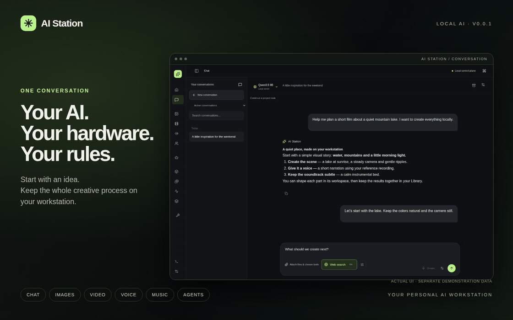
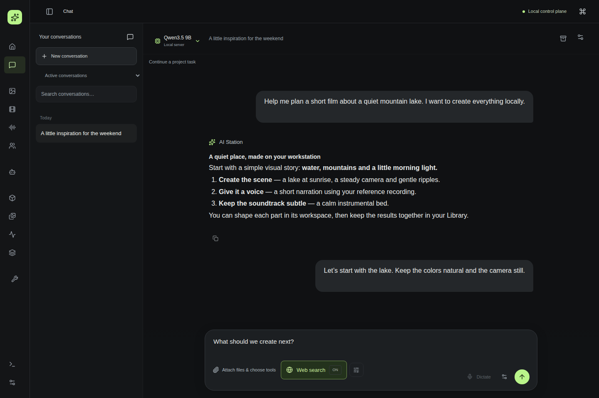
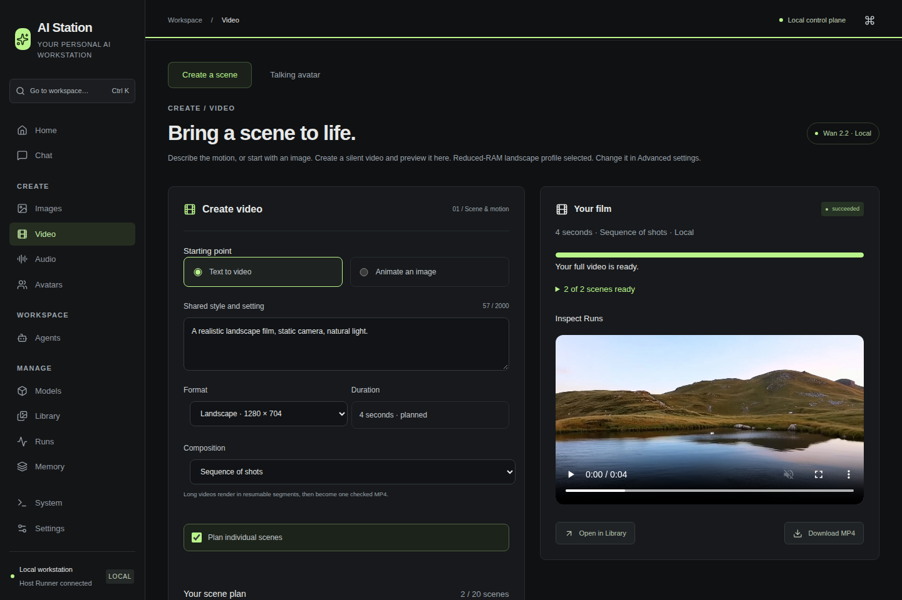
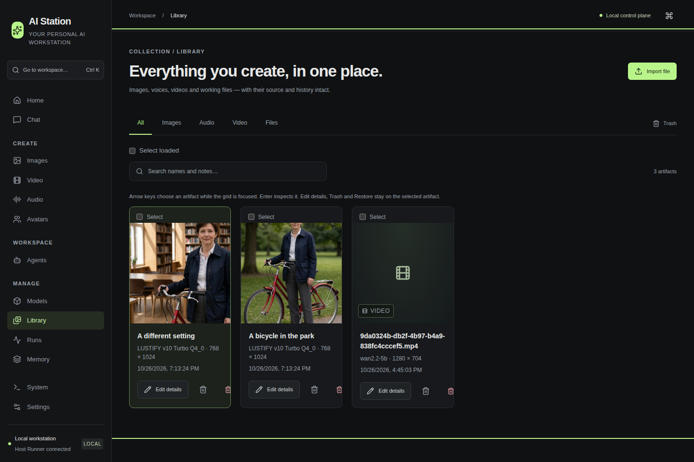
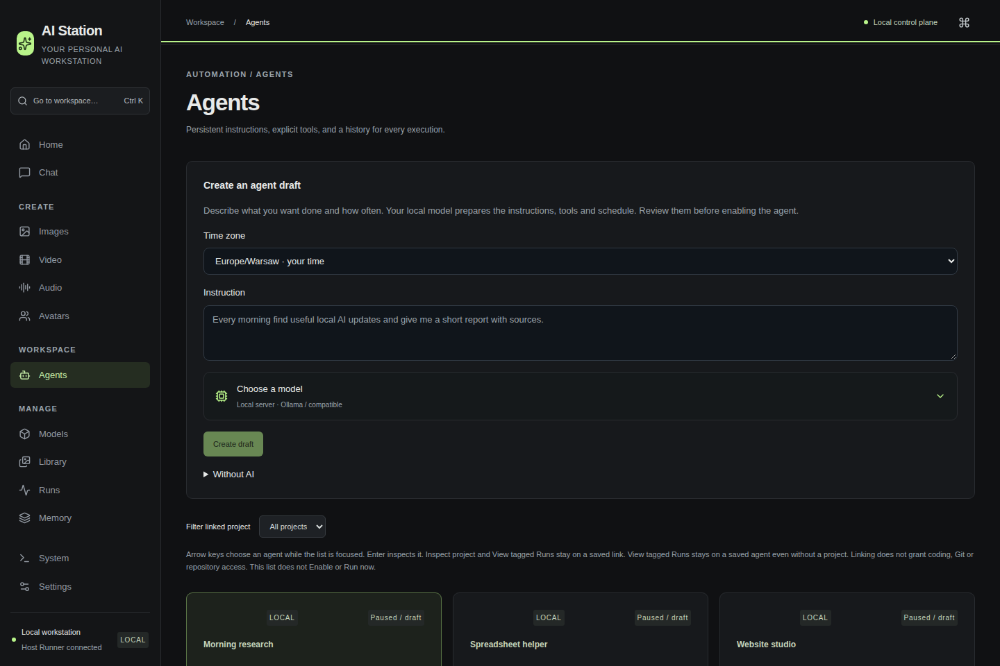
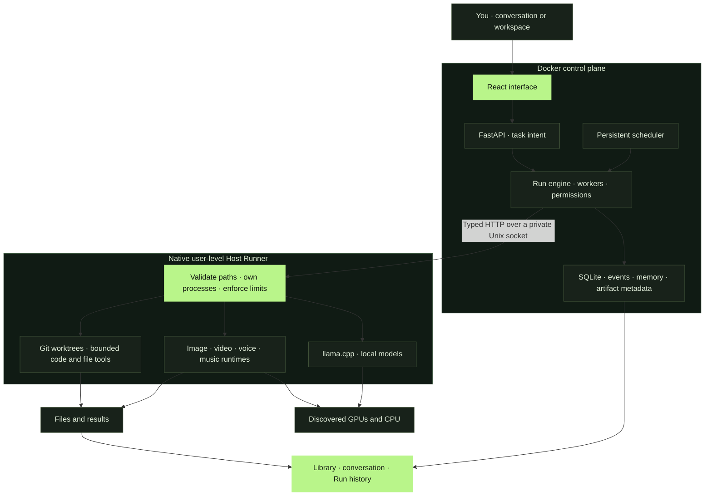

<div align="center">

# ✳ AI Station

### Your own AI. Made simple. No platform censorship.

**A familiar ChatGPT-style experience, on your own computer. No AI or IT background needed.**

Your conversations, images, videos, voices, music and agents — together, on your machine.

**Your models. Your rules. No cloud quotas or per-token fees for local generation.**

[Get started](#-get-started) · [See it in action](#-one-station-many-ways-to-create) · [Help us test](#help-make-it-simple) · [Real hardware results](#-real-hardware-real-results) · [The vision](#-where-were-going)

`v0.1.2` · `Linux & Windows` · `Local inference` · `Cloud optional` · [Free for noncommercial use](LICENSE)



</div>

**Local AI should be for anyone with a capable computer.** You shouldn't need to
know what a model server is, use a terminal or understand GPUs to get started.
You bring the hardware. We're building an app that takes care of the setup.

Ask a question. Make an image or video. Create a voiceover or a soundtrack.
Put an agent to work. Keep your conversations, files and results in one familiar
workspace — powered by your own computer.

**The experience we're building:**

| ① Download | ② Install | ③ Create |
| --- | --- | --- |
| Get one app for your workstation. | Guided setup checks your hardware and offers models that fit. | Open the conversation and describe what you want. |

You should not have to learn how to run model servers, choose Python environments
or assemble separate AI tools. **Making local AI approachable is the product.**
The conversation is your starting point: describe what you want, and AI Station
coordinates the tools behind it. Dedicated workspaces are there when you want
more control.

> **Early access:** 0.1 brings desktop installers and guided model setup for
> Ubuntu 24.04 x86-64 and Windows 11 x64. macOS is not supported yet.
> Windows installation/first reply is CPU-tested; physical Windows NVIDIA tests
> and human evaluation of the new voice/film samples follow release.
> [Exact qualification and known issues](docs/releases/0.1.2.md).

**New in 0.1.2:** find older references across your whole Library, choose them
with larger previews, browse media first and see actual film/avatar stills.
Media jobs recover observation of an existing process after a lost worker without
automatically starting generation again. [What changed](docs/releases/0.1.2.md).

On `develop`, the next release adds **Models → Find new models**: search Hugging
Face or paste a publisher link, review hardware fit and licenses, then install
compatible conversation models, Qwen Image 2.1 checkpoints, F16 Wan 2.2 5B
video checkpoints, Chatterbox v3 T3 speech checkpoints, ACE-Step music checkpoints,
compatible CPU memory encoders and Sonic avatar checkpoints. Reviewed choices work
in their workspaces and compatible assistant/agent settings, with hardware and workload requirements shown before
download. These additions are not in the 0.1.2 installers; other media-model
families need a matching supported runtime. Sonic avatar import passed its complete
Linux installation and selected-model recording check.
Speech import passed an isolated Linux GPU
installation and first-recording check; this is not Windows GPU qualification.
Search results can also compare their top three models against this station's
hardware before any weight download, with context and storage requirements shown.
[Discovery and installation status](docs/plans/open-model-discovery.md).

Release 0.1 prioritizes reliable setup on Linux and Windows, your first local
result, and updates that keep your accounts, models and saved work.
[0.1 release notes and qualification status](docs/releases/0.1.2.md).

## Help make it simple

**We especially need testers and feedback.** Try AI Station on your hardware and
tell us what worked, what broke or what felt confusing. Setup friction and small
usability problems matter just as much as bugs. You don't need to write code to help.
Tell us what you tried, what you expected and what happened; include your operating
system and hardware if you know them. Please leave passwords and private files out
of public reports.
[Report a bug](https://github.com/jahu/ai-station/issues/new) ·
[Suggest an improvement](https://github.com/jahu/ai-station/issues/new?title=Suggestion%3A%20) ·
[Contribution guide](CONTRIBUTING.md).

## 🎛 One station. Many ways to create.

| You want to… | AI Station gives you… |
| --- | --- |
| **Talk and think** | Streaming conversations, local model selection, optional reasoning controls, attachments, web search and page reading. |
| **Make and transform images** | Generate, Edit, Recompose and Upscale; ordered references, prompts, parameters and reusable results. |
| **Create video and avatars** | Local video generation, multi-shot films, resumable segments and portraits animated against a recording or generated speech. |
| **Work with sound** | Speech from text and a reference voice, transcription and local music generation. |
| **Put agents to work** | Natural-language drafts, in-chat image model selection and approval, reviewed tools and permissions, schedules, history, in-app notices and confirmed single or bulk deletion. |
| **Do something with your files** | Local spreadsheet/document analysis, Python tools, generated files and isolated website/project workflows with follow-ups. |
| **Keep your creative work** | Your private media-first Library, searchable reusable inputs, film previews, source lineage, downloads, metadata, Trash and confirmed permanent deletion. |
| **Operate your workstation** | Owned llama.cpp models, GPU allocation, runtime health, memory, diagnostics and inspectable Runs. |

Optional [Fish S2 Pro speech](docs/plans/expressive-speech.md)
adds a model choice, delivery directions and pacing in Audio and reviewed speech
agents. Choose **Generate a voice** for expressive delivery, or **Use a recording**
to keep a particular speaker; a neutral recording can soften emotional delivery.
Slower/Faster adjusts speaking speed while preserving pitch; Natural keeps the
model's original pace.
It requires a configured two-GPU runtime and retains Fish Audio's separate
model license. Chatterbox remains the default; historical v0.0.2 packages are
unchanged.

<table>
<tr>
<td width="50%"></td>
<td width="50%"></td>
</tr>
<tr><td align="center"><strong>One conversation to begin.</strong></td><td align="center"><strong>A workspace when you want control.</strong></td></tr>
</table>

<details>
<summary>Explore the Library and agent workspace</summary>




</details>

*Screenshots show the actual application with a separate demonstration dataset.
Example conversation and agent text is seeded for privacy; the selected images
and landscape film come from recorded local generation. [Media provenance](docs/media/README.md).*

## 🔓 Local by choice. Yours to control.

**No platform censorship. No cloud inference account required for local workflows.** Run
compatible models on your workstation, keep your files and history there, and
choose the models you want — including compatible uncensored weights. You choose the model, its capabilities
and its behavior.

Compatible uncensored models can also be used for adult/NSFW creation. The chosen
model and runtime determine supported content and behavior; AI Station does not
remove a model's built-in restrictions or make every model format compatible.

You are responsible for the inputs you use, the content you create and how you
share it, including consent, privacy, intellectual-property rights, applicable
law and each model's license. The software is provided under the warranty and
liability terms of the [license](LICENSE); those terms do not override applicable
law or grant permission to misuse someone else's content or likeness.

Local generation uses your hardware, with no AI Station per-token charge. Your
conversations, artifacts and application state live on your workstation. External
inference is opt-in; web search, downloads and private remote access use networks.
Choose the tools you want for each task.

Model choice is broad; machine access stays explicit. Agents use reviewed tools,
owned workspaces and scoped permissions. You can inspect what ran, where it ran,
what changed and which files it produced.

Media jobs retain supervision across temporary database contention and can resume
inspection of an already-owned process after a worker disappears, without starting
generation again. [Recovery contract](docs/plans/media-lease-recovery.md).

## 🧭 How does it fit alongside other projects?

These projects cover overlapping ground. Here is where each places its emphasis
and why you might choose AI Station alongside them.

| Project | Its emphasis | AI Station's emphasis |
| --- | --- | --- |
| [Open WebUI](https://docs.openwebui.com/features/) | A broad AI interface spanning conversations, knowledge, tools, voice, images and automations. | Bring that conversation into a host-aware workstation with a shared lifecycle for models, media, local agent jobs and artifacts. |
| [LM Studio](https://lmstudio.ai/docs/app/offline) | Download and run local LLMs, chat with documents and serve local inference. | Coordinate LLMs alongside image, video, audio and persistent agent workflows in one place. |
| [AnythingLLM](https://docs.anythingllm.com/chatting-with-documents/introduction) | Document-centered workspaces, retrieval and [tool-using agents](https://docs.anythingllm.com/features/ai-agents). | Keep knowledge and agents alongside creative media, GPU resources and inspectable execution. |
| [ComfyUI](https://github.com/Comfy-Org/ComfyUI) | A visual graph and execution engine for generative-media workflows. | Offer an everyday conversation and focused workspaces while integrating configured media runtimes underneath. |
| [Pinokio](https://desktop.pinokio.co/) | Discover, install, launch and automate local apps. | Build a connected experience across tasks, conversations, models and results, rather than asking the user to manage each app separately. |
| [Maestro / RunMaestro](https://github.com/RunMaestro/Maestro) | Coordinate coding agents and multiple projects from a desktop command center. | Put coding-capable agents inside a broader personal AI workstation for media, research, files and automation. |

These tools can coexist. AI Station can use compatible existing services;
you do not have to replace a working local setup to adopt the control plane.

## ⚡ Real hardware. Real results.

Measured on an **Intel Core i7-6900K, 32 GB RAM and two NVIDIA RTX 3060 12 GB cards**.
This is the development workstation, not a minimum requirement or a hard-coded
hardware profile. Two GPUs provide separate 12 GB devices, not a universal 24 GB pool.

| Workload | Recorded settings | Observed result |
| --- | --- | --- |
| **Local LLM generation** | RVN 27B Q4_K_M; llama.cpp; both GPUs; 46,080-token context allocation; Q8 KV cache; 467 prompt / 345 generated tokens | **16.9 generated tokens/s**; prompt processing **380.2 tokens/s**, measured separately. |
| **Generate an image** | LUSTIFY v10 Turbo Q4_0; 768×1024; 8 steps; CFG 1; two-GPU profile | **1 min 40 s** |
| **Edit an image** | Same model/size/steps; one reference, aligned layout | **2 min 27 s** |
| **Recompose an image** | Same model/size/steps; one reference, beside layout | **2 min 29 s** |
| **Recompose with two references** | Same model/size/steps; ordered scene and person references | **3 min 10 s** |
| **Generate two video shots in parallel** | Wan2.2 5B; 2 × 2-second shots; 1280×704; 20 steps; separate GPUs | **7 min 58 s** for the full four-second film and composition. |
| **Generate a continuous one-minute film** | Wan2.2 5B; 1280×704; 24 fps; 20 steps; 18 sequential windows; bounded host RAM | **3 h 16 min** for the complete 1,440-frame workflow. |
| **Create a one-minute speaking avatar** | EchoMimic V3; 384 px; 8 steps; 24 windows; one GPU; 60-second recording | **48 min 18 s**, including fresh source-speech preparation and composition. |
| **Create a whole-recording avatar with more detail** | Sonic; native 512×768; 25 steps; both GPUs; complete 40.08-second recording | **2 h 27 min 18 s** end to end; 1,002 frames at 25 fps. Owner confirms substantially improved quality; not native HD. |

These are recorded observations, not a cross-project benchmark or a speed promise.
The LLM row is one captured completion; allocated context is not prompt length.
Media times include their recorded Run/workflow boundaries, not diffusion-only
kernel speed. Historical long-video and Echo avatar results retain their observed
color/facial-detail limitations. The newer Sonic result received positive owner
feedback; duration success alone is not a promise of perfect visual quality.
[Method, exact scope and evidence](docs/benchmarks.md).

## 🚀 Get started

**[Try the current release →](https://github.com/jahu/ai-station/releases/latest)**

Download the package for your computer from the release assets:

- **Windows 11 x64:** `AI-Station-0.1.2-windows-x64-Setup.exe`.
- **Ubuntu 24.04 x86-64:** `AI-Station-0.1.2-linux-amd64.deb`.

Open AI Station, follow the setup, create your administrator account and choose
a recommended model. Downloads show their size and license before you agree.
Python and the app are bundled; the installer guides required OS permissions.
Windows uses its own WSL2 environment and may require an OS restart.
Model downloads and larger media need additional disk space and suitable hardware.

**Windows installer notice:** 0.1 is **not digitally signed**. Windows may show
an unknown-publisher/SmartScreen warning; Smart App Control or managed-device
policies may block it. Use only this repository's official assets and compare
`SHA256SUMS`. Do not disable system protections. Signing is planned for a later
release. A checksum checks file identity; it does not replace a code signature.

[Installation, updates and known issues](docs/releases/0.1.2.md).
The manual Linux path remains available below for advanced users.

<details>
<summary><strong>Advanced: manual Linux setup from source</strong></summary>

**Current release prerequisites:** Linux, Git, Python 3.12 with venv support,
Docker Engine and Docker Compose. GPU media additionally requires a compatible
configured runtime and model. The currently exercised media paths use NVIDIA/CUDA;
other GPU vendors remain a compatibility goal, not a blanket hardware-support claim.

```bash
git clone --branch master https://github.com/jahu/ai-station.git
cd ai-station
cp .env.example .env
./scripts/bootstrap.sh
# Configure your existing model/runtime paths in .env — see the setup guide.
./scripts/start.sh
```

Open **http://127.0.0.1:8765**. Your models and integrations report their real
availability; starting the app does not silently download a model collection.

**[Follow the setup guide →](docs/getting-started.md)** for configuration, existing
llama.cpp/Ollama services, optional media runtimes and development commands.
[Download the latest release](https://github.com/jahu/ai-station/releases/latest).
[What's new in 0.0.2](docs/releases/0.0.2.md). `master` is the release branch; contributors work through
feature branches and PRs into `develop`.

</details>

<details>
<summary><strong>Explore 0.1 features and guided model setup</strong></summary>

**0.1.2** follows the [release plan](docs/plans/next-release-0.1.md):
private accounts, persistent creative workspaces, prompt/search improvements,
expressive audio, timeline editing and guided setup. Qualified hardware and
post-release QA are listed in the [release notes](docs/releases/0.1.2.md).

Private accounts provide per-user
conversations, Library, memory and agents, with shared models/hardware, optional
two-factor authentication and administrator management. They are an explicit
access-profile cutover; see [accounts and migration](docs/accounts.md).

**Models → Set up a local model** offers reviewed local
conversation-model downloads. See actual RAM/VRAM and free application storage,
accept the model license, stop/resume preparation and open Chat after verification.
This Linux route can prepare a reviewed llama.cpp runtime image, then download
your selected model. Existing configured images stay available. Cross-platform
launchers and full media setup remain in progress.
[Guided setup and measured qualification](docs/plans/guided-model-installation.md).

On Linux x86-64 without an NVIDIA GPU, model setup offers a small **CPU
conversation model**. Review its source and RAM estimate, prepare the engine,
then open Chat. This explicit profile uses system RAM and a 4096-token context;
it is slower than GPU inference. Existing GPU/external models stay selected
until you choose another model. [CPU setup](docs/plans/guided-cpu-conversation.md).

On supported Linux NVIDIA workstations, the same page offers **Set up local
speech**: review hardware, storage and component licenses, prepare Chatterbox,
then open Audio with your reference recording. Setup history and Stop/Resume are
saved; an existing configured speech runtime keeps priority. This setup
flow prepares its own Python and offline dependencies, rather than asking you to
wire up a separate environment.
[Speech setup and qualification](docs/plans/managed-speech-setup.md).


On supported Linux NVIDIA workstations with two 12-GiB GPUs, **Set up images**
reviews the Qwen/RealESRGAN sources and licenses, prepares the engine and all
companions, and opens the saved Images workspace for Generate, Edit, Recompose
and Upscale. Stop/Resume and download verification use normal private Runs;
existing configured image integrations keep priority.
[Image setup and measured qualification](docs/plans/managed-image-setup.md).

**Set up memory** prepares a small multilingual CPU model for searching saved
knowledge by meaning. The app shows sources, license and storage before setup;
your GPUs stay free and memory content remains private. Existing embedding
endpoints remain selected unless you explicitly replace them.
[Memory setup](docs/plans/memory-embeddings-readiness.md).

Development builds can also inspect and install compatible E5 F32 encoder bundles
from a Hugging Face link. Hardware and complete storage estimates come first;
choosing **Use for memory** explicitly switches the CPU encoder and rebuilds your
private index. [Supported imports](docs/models.md#discovered-memory-encoder-bundles-candidate-under-qualification).

**Set up music** prepares ACE-Step 1.5 Turbo on supported Linux NVIDIA
workstations with at least 12 GiB VRAM and 24 GiB system RAM. Review sources and
component licenses, install with saved progress and Stop/Resume, then create an
instrumental or use your own lyrics in Music. This profile uses CPU offload;
existing configured ACE-Step environments keep priority.
[Music setup and measured qualification](docs/plans/managed-music-setup.md).

Development builds also support explicit installation and selection of
compatible ACE-Step music checkpoints from publisher links, with complete
hardware/component review and preserved engine bindings.
[Music model imports](docs/models.md#discovered-music-bundles-under-qualification).

**Set up video** prepares Wan 2.2 5B on supported Linux NVIDIA workstations
with at least 12 GiB VRAM, 24 GiB system RAM and a compatible driver. Review
sources, component licenses and storage, then install with saved progress and
Stop/Resume. Create a scene, animate an image or continue a longer film in Video;
the prepared environment also handles final composition and CPU timeline export.
Existing configured video integrations keep priority.
[Video setup and measured qualification](docs/plans/managed-video-setup.md).


**Set up avatars** prepares Sonic on supported Linux NVIDIA workstations with
at least 12 GiB VRAM, 24 GiB system RAM and a compatible driver. Review the
component licenses, install with saved progress and Stop/Resume, then animate a
portrait with your complete recording. The prepared engine includes its own
Python and finishing codec. Existing Sonic and EchoMimic configurations are
preserved; installing Sonic does not install EchoMimic. Output is up to 768 px,
rather than native HD. [Avatar setup and qualification](docs/plans/managed-avatar-setup.md).

**Set up sound effects** prepares the existing MMAudio film-sound engine,
companions and CPU finishing tools on supported Linux BF16-capable NVIDIA
workstations. Review hardware, space and component terms, install with saved
Stop/Resume, then add scene sounds to a film in Audio. This is a **research
profile**: the Apple CLIP component has a research-only license and MMAudio
checkpoints have separate noncommercial terms. Existing configured engines stay
selected. [Sound setup and measured qualification](docs/plans/managed-effects-setup.md).

**Set up expressive voice** prepares Fish S2 Pro and local reference transcription
on supported Linux BF16-capable NVIDIA workstations with two GPUs (10 + 5 GiB
VRAM) and 24 GiB system RAM. Add a phone recording, enter your script and choose
delivery and pace in Audio. Model weights stay on GPUs; setup progress and
Stop/Resume use private ordinary Runs. Existing Fish/Whisper settings retain
priority. Review the component licenses before installation.
[Expressive voice setup and qualification](docs/plans/managed-fish-setup.md).

Desktop packages bundle Python and the application image, open
account/model setup in your browser and keep data outside the installed package.
Clean installation, a real first CPU conversation and preserving update/reinstall
have been verified on [Linux x86-64](docs/plans/linux-consumer-qualification.md)
and [Windows 11 / WSL2](docs/plans/windows-consumer-installation.md).
The Linux package explains any required Docker permission through a native dialog
and keeps the app running as your ordinary user. Physical Windows NVIDIA and
combined fresh Linux GPU qualification remain unverified; CPU first use and
existing Linux GPU profiles have separate actual evidence.
[Desktop packaging and status](docs/plans/desktop-installation.md).

**Known issue — macOS:** the native installer is **not supported in release 0.1**.
Full installed startup remains unreliable; the latest attempt timed out waiting
for Docker Desktop's local engine before account/model setup. Passing native
component tests does not establish a working Mac installation. Mac work is
deferred so it does not delay Linux and Windows. Existing experimental source
and evidence are retained. [Mac status](docs/plans/macos-consumer-installation.md).

Development builds also retain creative sessions across Images, Video, Music,
Speech and Avatars. Measured generation stages and scoped time estimates use
saved observations rather than a simulated countdown. See
[creative workspaces](docs/creative-workspaces.md) and
[generation progress](docs/plans/generation-progress.md).

Development builds offer **Improve my prompt locally** in Images, Video, Music
and Echo avatar workspaces. Choose your local preparation model in Settings →
Generation, optionally review its wording, and keep the original beside the
effective prompt. Lyrics and spoken scripts are preserved. Fixed Sonic and
upscale operations have no descriptive prompt to enhance.
[Prompt preparation contracts](docs/plans/local-prompt-enhancement.md).

For edits, **Auto · match this edit** offers a visible
model recommendation. Pose changes and object removal can use Qwen while explicit
LUSTIFY choices remain available. [Image workflows](docs/image-workflows.md).

Speech offers optional **Shape the delivery** controls for a
compatible configured Chatterbox CLI. Expression, guidance and variation stay with
each version; the spoken script and standard defaults remain intact.
[Speech controls and qualification](docs/plans/expressive-speech.md).

**Sound effects** in Audio lets you choose a completed
film, describe its sounds and keep both a reusable WAV track and a synchronized
video preview. **Add sound** on a film opens the saved workspace with that source.
The optional offline MMAudio runtime uses one GPU and retains its separate
noncommercial model license. [Configuration and qualification](docs/plans/synchronized-sound.md).

### Saved film editing

Video → **Edit a film** opens a saved editing workspace. Add inspected films and
WAV speech, music or effects from Library; trim, move and reorder clips, adjust
volume, mute and fades, and inspect measured waveforms. Save immutable edits and
return to them later. **Preview this edit** renders the actual saved mix;
**Export film** downloads that same verified result. Changing the draft marks an
older preview and requires a new render before export. Source files and earlier
results remain in Library. CPU rendering uses an owned four-GiB/zero-swap scope
and does not unload GPU models. See [timeline contracts](docs/plans/media-timeline.md)
for supported timing, private ownership and qualification gates.

### Film sound agents

In an agent's **Create media** settings choose **Sound effects**, select a film
from your Library and describe what should be heard. Optional scene directions
keep exact start/end times. Use the saved description each run, or let the
selected local model write a new overall description from the reviewed goal.
The film, scene directions and generation settings stay fixed. Review and enable
the definition, then Run now or use its saved schedule. Each execution retains a
separate effects WAV and a synchronized video preview; the original film remains
unchanged. Missing sources or an unavailable local engine block activation.


### Film sound in the conversation

Ask **“Add sound to this film: rain on the leaves”** after a completed film,
or choose **Attach files & choose tools → Add film sound** and select it from
Library. Original audio is kept by default; replacing it is an explicit option.
For a new film, choose **Generate video → Add sound to this film** and describe
what should be heard. The conversation retains a synchronized movie, separate
WAV and **Edit sound mix** link to its saved timeline. Film, effects and mixing
share one inspectable, stoppable task. This uses the optional configured MMAudio
runtime above; narration and music remain separate capabilities.

</details>

## 🌱 Where we're going

The ambition is simple: **a person with a home GPU should be able to install
AI Station and start creating without learning model servers, Python environments
or GPU flags.** A familiar chat experience, plus local tools for the things you
would otherwise spread across separate AI apps.

- **Guided first launch:** detect hardware, explain what fits and offer sensible defaults.
- **Model setup inside the app:** explicit downloads, verified files, progress, cancellation and storage estimates.
- **Easier media setup:** prepare compatible runtimes and presets instead of asking people to wire them together.
- **Hardware-aware choices:** propose a model, quantization and context that fit the available devices.
- **A friendlier daily experience:** clearer language, strong mobile UX and optional push notifications.
- **More capabilities over time:** additional models, runtimes and devices through the existing execution boundaries.

The goal is the familiarity of a ChatGPT-style conversation and a creative suite,
powered by local models such as llama.cpp-compatible LLMs, Wan, Sonic, EchoMimic,
Chatterbox and ACE-Step. [The consumer setup plan](docs/plans/consumer-first-setup.md)
keeps that direction concrete.

## 🏗 A workstation, with a control plane

The interface can be simple while the execution stays visible.
Every workload follows **Task → Run → Events → Artifacts**.



The Docker control plane gets no privileged container, Docker socket or unrestricted
host mount. The native Runner exposes typed operations, not an arbitrary shell.
Existing external services keep their ownership. Cloud providers are optional
adapters, not a dependency of the local execution path.

<details>
<summary><strong>For builders: architecture, development and verification</strong></summary>

The foundation is a modular monolith: FastAPI, SQLAlchemy/Alembic and SQLite WAL,
React/TypeScript/Vite, a durable worker/scheduler and a private native bridge.

```bash
./scripts/dev.sh
./scripts/check-all.sh
```

Normal tests use temporary databases and fake executors. Expensive real integrations
are opt-in. The 0.1 Python regression passed **8,020 tests**, with 19 explicit skips;
late package/helper changes additionally passed 77 and 159 affected cases.
Frontend/build and actual packaged platform evidence is recorded separately;
unchanged code is not described as freshly retested. The offline QA tools pass
29 tests. These results do not automatically qualify every model, media profile
or machine.
[Release verification](docs/releases/0.1.2.md#validation) ·
[Historical verification](docs/verification.md) · [Operator QA](docs/qa/README.md).

Read [CONTRIBUTING.md](CONTRIBUTING.md) and [AGENTS.md](AGENTS.md) before contributing. The [setup/development guide](docs/getting-started.md)
also explains how to add executors, capabilities, providers, tools and connectors.

</details>

| Explore | Guides |
| --- | --- |
| Project landing page | [Standalone website source and local preview](website/README.md) |
| Understand the platform | [Architecture](docs/architecture.md) · [Security](docs/security-model.md) · [Execution](docs/execution-model.md) |
| Run local models | [Models](docs/models.md) · [llama.cpp](docs/managed-llama.md) · [Chat](docs/local-chat.md) |
| Create media | [Images](docs/image-workflows.md) · [Video](docs/video.md) · [Avatars](docs/avatars.md) · [Audio](docs/audio.md) |
| Work with agents | [Agents](docs/agents.md) · [Projects](docs/projects.md) · [Memory](docs/memory.md) |
| Operate your station | [Library](docs/library.md) · [Private access](docs/private-network-access.md) · [Backups](docs/operations.md) |

---

## 📜 License

**Free for noncommercial use. Commercial use requires a separate written license.**
AI Station is source-available under [PolyForm Noncommercial 1.0.0](LICENSE),
including its expressly permitted organizational uses. You can inspect, modify
and share it for permitted purposes. [Commercial licensing and details →](COMMERCIAL.md)

Contributions are welcome; contributors retain their copyright and provide the
separate permission needed for commercial licensing. Models and dependencies
keep their own licenses. [Contribution guide](CONTRIBUTING.md) · [Required notice](NOTICE)

**Local AI, made simple.** ✳
