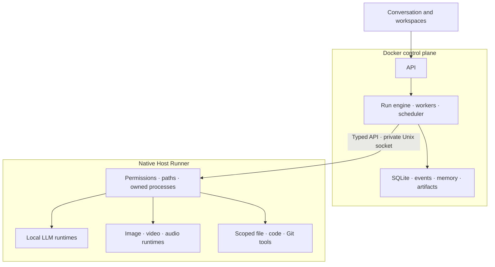

<div align="center">

# ✳ AI Station

### Your own AI. Made simple. No platform censorship.

Chat, images, video, voices, music and agents — on your own computer.

**[Download 0.7.0](https://github.com/jahu/ai-station/releases/tag/v0.7.0)** · **[See it in action](https://ai-station.dev/)** · [Installation guide](https://ai-station.dev/install/) · [Release notes](docs/releases/0.7.0.md)

Linux & Windows · Local inference · Cloud optional · [Free for noncommercial use](LICENSE)


</div>

AI Station brings local AI into one app. Ask a question, drop in an image, make a
film or describe a recurring job. Start in the conversation; open a dedicated
workspace when you want more control.

You don't need to assemble separate model servers and creative tools. Guided
setup checks your hardware and helps you install compatible models. Your files,
conversations and generated work stay on your machine. Local generation has no
AI Station subscription or per-token fee.

This is an early release. **We need testers and honest feedback**, especially on
installation and everyday use. [Tell us what worked, what broke or what was confusing.](https://github.com/jahu/ai-station/issues/new)

## Get started

| Your computer        | Official installer                                                                                                       |
| -------------------- | ------------------------------------------------------------------------------------------------------------------------ |
| Windows 10 / 11, x64 | [Download Setup.exe](https://github.com/jahu/ai-station/releases/download/v0.7.0/AI-Station-0.7.0-windows-x64-Setup.exe) |
| Ubuntu 24.04, x86-64 | [Download .deb](https://github.com/jahu/ai-station/releases/download/v0.7.0/AI-Station-0.7.0-linux-amd64.deb)            |

1. Install and open AI Station.
2. Create your account and follow guided setup. Review model sizes and licenses
   before downloading.
3. Open the conversation and describe what you want to do.

The app bundles Python and its application components. Windows setup prepares its
own WSL2 environment; Docker Desktop and a separate Ubuntu installation are not
needed. Windows 10 requires 21H2/22H2 with KB5020030 or a newer cumulative update.

**Before installing:** Windows packages are currently unsigned. Use the official
assets and `SHA256SUMS`; don't disable Windows security. Linux NVIDIA media has
real GPU qualification; physical Windows GPU testing is still pending. macOS is
not supported yet. Models need additional disk space, and available features depend
on your hardware. [Full installation steps and requirements →](https://ai-station.dev/install/)

Already using the desktop app? Open **Settings → Updates → Update and restart**.
Version 0.4 and older need a one-time installation of the newer desktop client.

## What can I do with it?

| Workspace                    | Use it for                                                                                                                                                          |
| ---------------------------- | ------------------------------------------------------------------------------------------------------------------------------------------------------------------- |
| **Chat and research**        | Pick a local LLM, attach files, search the web and read pages. Follow up in the same conversation.                                                                  |
| **Create and edit images**   | Generate an image, edit it using reference images, or upscale a result. Choose compatible models, including uncensored weights.                                     |
| **Make videos and avatars**  | Animate a still image, create scenes from text, add generated sound, or turn a portrait and recording into a speaking presenter.                                    |
| **Make audio and music**     | Generate speech, use a reference voice, transcribe recordings and create instrumental or vocal tracks.                                                              |
| **Produce a finished film**  | Creative Studio brings shots, narration, music and captions into an editable storyboard and MP4 export, with reusable brand identities.                             |
| **Create agents**            | Describe a job and schedule. Review the proposed tools and permissions, then enable it. Agents can research, create media, analyze files and run scoped local code. |
| **Keep and reuse your work** | Find results in your private Library, reuse them as inputs, download them, or delete them through Trash or permanent deletion.                                      |

**Why AI Station?** The focus is making local AI usable as one product. Conversation,
creative tools, models and recurring jobs share the same workspace and history.
You can inspect what ran, stop it and keep its results. Existing compatible local
services can stay in place. [How it fits alongside other tools →](docs/alternatives.md)

## Made locally

These examples were created in AI Station on an i7-6900K workstation with
32 GB RAM and two RTX 3060 12 GB cards. They come from a separate demo account.

<p align="center">
  <a href="website/assets/showcase/maya-original.webp"></a>
  <a href="website/assets/showcase/maya-edited.webp"></a>
</p>

**Generate, then edit.** Qwen created the portrait; LUSTIFY changed the outfit.
[Original prompt](website/assets/showcase/portrait-workspace.webp) · [Edit settings](website/assets/showcase/edit-workspace.webp)

[](https://ai-station.dev/#showcase)

| Try the examples                                          | What you'll see or hear                                                       |
| --------------------------------------------------------- | ----------------------------------------------------------------------------- |
| [Film with sound](https://ai-station.dev/#showcase)       | A generated photograph animated with Wan, with a local MMAudio soundscape.    |
| [Text to video](https://ai-station.dev/#text-to-video)    | An eight-second coastal film with sound, made from a written description.     |
| [Speaking avatar](https://ai-station.dev/#workflow-title) | A fictional studio presenter created and animated in one conversation.        |
| [Music](https://ai-station.dev/#music-title)              | Two original 45-second tracks: a cinematic instrumental and English synthpop. |
| [Agents](https://ai-station.dev/#agents-showcase)         | Agent ideas and a recorded market-research example with its report and chart. |

The website also has English speech samples and clearly labeled synthetic voice
impressions. These are demonstrations, not endorsements or built-in celebrity
presets. Public media and its sources are recorded in [asset provenance](website/asset-provenance.json).
Direct publishing to social networks is still planned.

## New in 0.7.0

**Longer, more consistent video with Wan 2.2 SVI Pro.** The new engine carries the
original image and motion context between windows, helping the subject and scene
stay consistent as the clip continues.

- Landscape 832×480 or portrait 480×832, at 15 fps.
- Shared model and format selection in Chat, Video, agents and Studio.
- Optional setup through **Video → Set up video → Continuous video**.

Real Linux GPU tests include complete 10-second clips and a 20-second scene.
This profile favors consistency over speed: a 10-second clip took about
**1 h 46 min** on one RTX 3060 12 GB. Detail is 480p-class; framing and motion can
still be imperfect. [Release notes and exact test coverage →](docs/releases/0.7.0.md)

## Real hardware, real timings

Recorded on the workstation above. Two 12 GB cards are separate devices;
individual runtimes determine whether a job can use both.

| Workload         | Model and settings                                             | Measured time or speed      |
| ---------------- | -------------------------------------------------------------- | --------------------------- |
| Local chat       | RVN 27B Q4_K_M, llama.cpp, both GPUs, one 345-token completion | **16.9 generated tokens/s** |
| Image generation | LUSTIFY v10 Turbo Q4_0, 768×1024, 8 steps                      | **1 min 40 s**              |
| Continuous video | SVI Pro Q4, 832×480 or 480×832, 15 fps, one GPU, 10 seconds    | **About 1 h 46 min**        |
| Speaking avatar  | Sonic, 512×768, both GPUs, complete 40.08-second recording     | **2 h 27 min 18 s**         |

These are recorded runs, not speed promises. Historical image timings exclude the
new Edit inspection and review stages. Hardware, model, settings and job length
change the result. [Full measurements and methodology →](docs/benchmarks.md)

## Your models, your data

AI Station adds no platform content filter. Compatible uncensored models can
support adult/NSFW creation; each model still has its own capabilities, behavior
and license.

Local inference needs no cloud AI account. External providers are optional;
web search and downloads use the network. Private accounts separate conversations,
Library, memory and agents while sharing installed models and hardware.
[Private remote access](docs/private-network-access.md) supports using your station
from another device.

## Under the hood

A Docker control plane manages the interface, state and queue. A native user-level
Host Runner handles the GPUs, local processes and validated file access.
Work follows **Task → Run → Events → Artifacts**, with inspectable history.



The control plane gets no privileged container, Docker socket or unrestricted
host mount. The Runner exposes typed operations. Existing external runtimes
retain their ownership. [Architecture](docs/architecture.md) · [Security](docs/security-model.md)

<details>
<summary>Develop or install from source</summary>

Linux prerequisites: Git, Python 3.12 with venv support, Docker Engine and Compose.
Configure existing model/runtime paths in `.env` as described in the setup guide.

```bash
git clone --branch master https://github.com/jahu/ai-station.git
cd ai-station
cp .env.example .env
./scripts/bootstrap.sh
./scripts/start.sh
```

Open **http://127.0.0.1:8765**. For development, use `./scripts/dev.sh`;
run `./scripts/check-all.sh` for verification. Normal tests use fake executors;
real integrations are opt-in. Feature PRs target `develop`.

[Setup and extension guide](docs/getting-started.md) · [Contributor guidance](AGENTS.md) · [Contributing](CONTRIBUTING.md)

</details>

## Help us improve it

Try it on your hardware. Report what you tried, what you expected and what
happened — bugs and confusing UX both matter. Please remove private files and
credentials from public reports.

[Report a bug or suggest an improvement](https://github.com/jahu/ai-station/issues/new) · [Operator QA checklist](docs/qa/README.md)

| Learn more          | Guides                                                                                                                                                                                |
| ------------------- | ------------------------------------------------------------------------------------------------------------------------------------------------------------------------------------- |
| Use your station    | [Chat](docs/local-chat.md) · [Models](docs/models.md) · [Library](docs/library.md) · [Memory](docs/memory.md)                                                                         |
| Create and automate | [Images](docs/image-workflows.md) · [Video](docs/video.md) · [Avatars](docs/avatars.md) · [Audio](docs/audio.md) · [Agents](docs/agents.md) · [Studio](docs/plans/creative-studio.md) |
| Run and maintain    | [Installation](docs/getting-started.md) · [Backups](docs/operations.md) · [Verification](docs/verification.md)                                                                        |

## License

Source-available under [PolyForm Noncommercial 1.0.0](LICENSE).
**Free for permitted noncommercial use; other commercial use requires a separate written license.**
Models and dependencies retain their own licenses.
[Commercial licensing](COMMERCIAL.md) · [Contribution terms](CONTRIBUTING.md) · [Notice](NOTICE)
