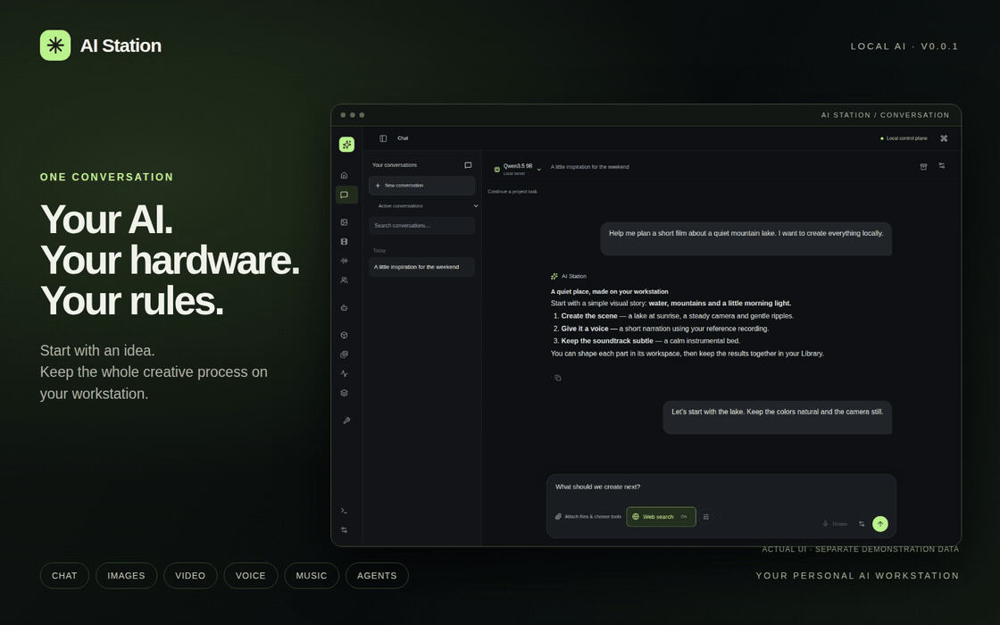
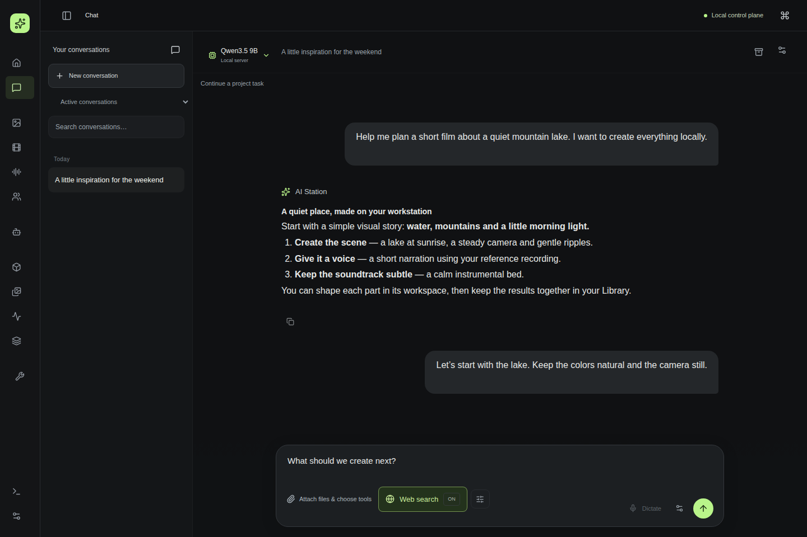
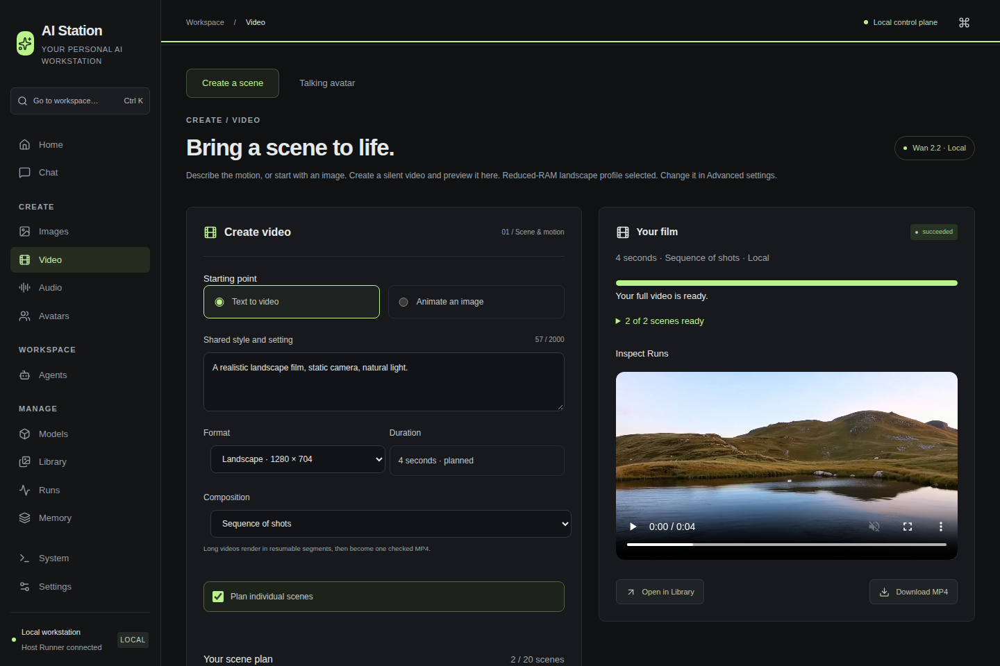
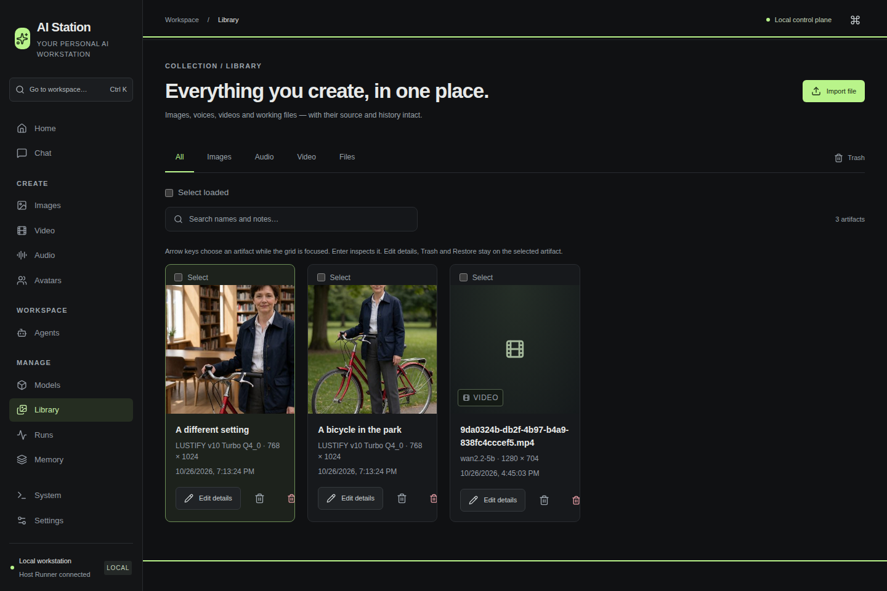
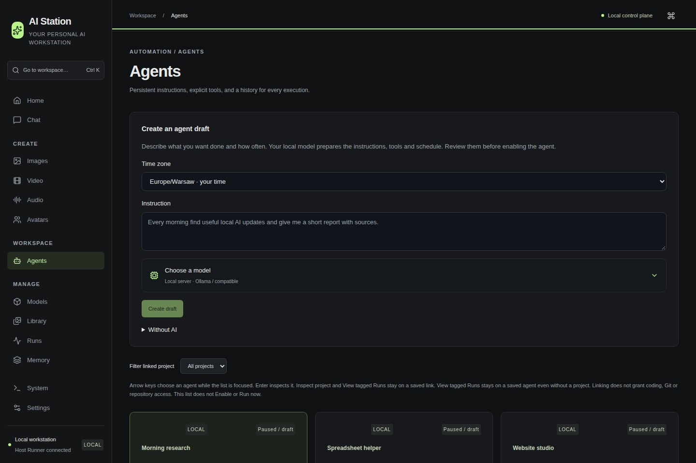
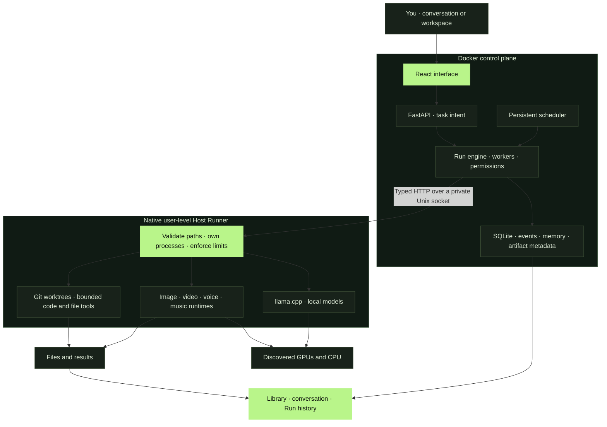

<div align="center">

# ✳ AI Station

### Your AI. Your hardware. Your rules.

**Chat. Create. Automate. One local workstation.**

Your models, images, videos, voices, music and agents — together, on your machine.

[Get started](#-get-started) · [See it in action](#-one-station-many-ways-to-create) · [Real hardware results](#-real-hardware-real-results) · [The vision](#-where-were-going)

`v0.0.2` · `Linux first` · `Local inference` · `Cloud optional` · [Free for noncommercial use](LICENSE)



</div>

Imagine describing what you want and letting your own computer do the work.
An answer. A photograph. A short film. A voiceover. A soundtrack. An agent that
keeps working after you close the conversation.

**That is what we are building.** AI Station brings local AI into one workspace,
with a familiar conversation at the center and dedicated tools when you want
more control. Start with an idea; keep the conversation, files and results together.

> **The destination:** download, install, create. Your hardware is detected,
> compatible models are offered and the setup takes care of itself.
> **Today:** v0.0.2 is a working, Linux-first workstation release. You still need
> Docker, Python and configured local models/runtimes. Guided setup, model downloads
> and broader GPU compatibility are on the roadmap — not hidden prerequisites
> disguised as completed features.

## 🎛 One station. Many ways to create.

| You want to… | AI Station gives you… |
| --- | --- |
| **Talk and think** | Streaming conversations, local model selection, optional reasoning controls, attachments, web search and page reading. |
| **Make and transform images** | Generate, Edit, Recompose and Upscale; ordered references, prompts, parameters and reusable results. |
| **Create video and avatars** | Local video generation, multi-shot films, resumable segments and portraits animated against a recording or generated speech. |
| **Work with sound** | Speech from text and a reference voice, transcription and local music generation. |
| **Put agents to work** | Natural-language drafts, reviewed tools and permissions, schedules, history and in-app notices. |
| **Do something with your files** | Local spreadsheet/document analysis, Python tools, generated files and isolated website/project workflows with follow-ups. |
| **Keep your creative work** | A shared Library, source lineage, downloads, metadata, Trash and confirmed permanent deletion. |
| **Operate your workstation** | Owned llama.cpp models, GPU allocation, runtime health, memory, diagnostics and inspectable Runs. |

<table>
<tr>
<td width="50%"></td>
<td width="50%"></td>
</tr>
<tr><td align="center"><strong>One conversation to begin.</strong></td><td align="center"><strong>A workspace when you want control.</strong></td></tr>
</table>

<details>
<summary>Explore the Library and agent workspace</summary>




</details>

*Screenshots show the actual application with a separate demonstration dataset.
Example conversation and agent text is seeded for privacy; the selected images
and landscape film come from recorded local generation. [Media provenance](docs/media/README.md).*

## 🔓 Local by choice. Yours to control.

**No cloud inference account is required for configured local workflows.** Run
compatible models on your workstation, keep your files and history there, and
choose the models you want — including compatible uncensored weights. You choose the model, its capabilities
and its behavior.

Compatible uncensored models can also be used for adult/NSFW creation. The chosen
model and runtime determine supported content and behavior; AI Station does not
remove a model's built-in restrictions or make every model format compatible.

You are responsible for the inputs you use, the content you create and how you
share it, including consent, privacy, intellectual-property rights, applicable
law and each model's license. The software is provided under the warranty and
liability terms of the [license](LICENSE); those terms do not override applicable
law or grant permission to misuse someone else's content or likeness.

Local generation uses your hardware, with no AI Station per-token charge. Your
conversations, artifacts and application state live on your workstation. External
inference is opt-in; web search, downloads and private remote access use networks.
Choose the tools you want for each task.

Model choice is broad; machine access stays explicit. Agents use reviewed tools,
owned workspaces and scoped permissions. You can inspect what ran, where it ran,
what changed and which files it produced.

## 🧭 How does it fit alongside other projects?

These projects cover overlapping ground. Here is where each places its emphasis
and why you might choose AI Station alongside them.

| Project | Its emphasis | AI Station's emphasis |
| --- | --- | --- |
| [Open WebUI](https://docs.openwebui.com/features/) | A broad AI interface spanning conversations, knowledge, tools, voice, images and automations. | Bring that conversation into a host-aware workstation with a shared lifecycle for models, media, local agent jobs and artifacts. |
| [LM Studio](https://lmstudio.ai/docs/app/offline) | Download and run local LLMs, chat with documents and serve local inference. | Coordinate LLMs alongside image, video, audio and persistent agent workflows in one place. |
| [AnythingLLM](https://docs.anythingllm.com/chatting-with-documents/introduction) | Document-centered workspaces, retrieval and [tool-using agents](https://docs.anythingllm.com/features/ai-agents). | Keep knowledge and agents alongside creative media, GPU resources and inspectable execution. |
| [ComfyUI](https://github.com/Comfy-Org/ComfyUI) | A visual graph and execution engine for generative-media workflows. | Offer an everyday conversation and focused workspaces while integrating configured media runtimes underneath. |
| [Pinokio](https://desktop.pinokio.co/) | Discover, install, launch and automate local apps. | Build a connected experience across tasks, conversations, models and results, rather than asking the user to manage each app separately. |
| [Maestro / RunMaestro](https://github.com/RunMaestro/Maestro) | Coordinate coding agents and multiple projects from a desktop command center. | Put coding-capable agents inside a broader personal AI workstation for media, research, files and automation. |

These tools can coexist. AI Station can use compatible existing services;
you do not have to replace a working local setup to adopt the control plane.

## ⚡ Real hardware. Real results.

Measured on an **Intel Core i7-6900K, 32 GB RAM and two NVIDIA RTX 3060 12 GB cards**.
This is the development workstation, not a minimum requirement or a hard-coded
hardware profile. Two GPUs provide separate 12 GB devices, not a universal 24 GB pool.

| Workload | Recorded settings | Observed result |
| --- | --- | --- |
| **Local LLM generation** | RVN 27B Q4_K_M; llama.cpp; both GPUs; 46,080-token context allocation; Q8 KV cache; 467 prompt / 345 generated tokens | **16.9 generated tokens/s**; prompt processing **380.2 tokens/s**, measured separately. |
| **Generate an image** | LUSTIFY v10 Turbo Q4_0; 768×1024; 8 steps; CFG 1; two-GPU profile | **1 min 40 s** |
| **Edit an image** | Same model/size/steps; one reference, aligned layout | **2 min 27 s** |
| **Recompose an image** | Same model/size/steps; one reference, beside layout | **2 min 29 s** |
| **Recompose with two references** | Same model/size/steps; ordered scene and person references | **3 min 10 s** |
| **Generate two video shots in parallel** | Wan2.2 5B; 2 × 2-second shots; 1280×704; 20 steps; separate GPUs | **7 min 58 s** for the full four-second film and composition. |
| **Generate a continuous one-minute film** | Wan2.2 5B; 1280×704; 24 fps; 20 steps; 18 sequential windows; bounded host RAM | **3 h 16 min** for the complete 1,440-frame workflow. |
| **Create a one-minute speaking avatar** | EchoMimic V3; 384 px; 8 steps; 24 windows; one GPU; 60-second recording | **48 min 18 s**, including fresh source-speech preparation and composition. |
| **Create a whole-recording avatar with more detail** | Sonic; native 512×768; 25 steps; both GPUs; complete 40.08-second recording | **2 h 27 min 18 s** end to end; 1,002 frames at 25 fps. Owner confirms substantially improved quality; not native HD. |

These are recorded observations, not a cross-project benchmark or a speed promise.
The LLM row is one captured completion; allocated context is not prompt length.
Media times include their recorded Run/workflow boundaries, not diffusion-only
kernel speed. Historical long-video and Echo avatar results retain their observed
color/facial-detail limitations. The newer Sonic result received positive owner
feedback; duration success alone is not a promise of perfect visual quality.
[Method, exact scope and evidence](docs/benchmarks.md).

## 🚀 Get started

**Current release prerequisites:** Linux, Git, Python 3.12 with venv support,
Docker Engine and Docker Compose. GPU media additionally requires a compatible
configured runtime and model. The currently exercised media paths use NVIDIA/CUDA;
other GPU vendors remain a compatibility goal, not a blanket hardware-support claim.

```bash
git clone --branch master https://github.com/jahu/ai-station.git
cd ai-station
cp .env.example .env
./scripts/bootstrap.sh
# Configure your existing model/runtime paths in .env — see the setup guide.
./scripts/start.sh
```

Open **http://127.0.0.1:8765**. Your models and integrations report their real
availability; starting the app does not silently download a model collection.

**[Follow the setup guide →](docs/getting-started.md)** for configuration, existing
llama.cpp/Ollama services, optional media runtimes and development commands.
[Download the latest release](https://github.com/jahu/ai-station/releases/latest).
[What's new in 0.0.2](docs/releases/0.0.2.md). `master` is the release branch; contributors work through
feature branches and PRs into `develop`.

Development toward **0.1.0** follows the [next-release plan](docs/plans/next-release-0.1.md):
private accounts, persistent creative workspaces, prompt/search improvements,
expressive audio, timeline editing and guided setup. These remain development
targets rather than features claimed for v0.0.2.

Private accounts are now implemented and qualified on `develop`: per-user
conversations, Library, memory and agents, with shared models/hardware, optional
two-factor authentication and administrator management. They are an explicit
access-profile cutover; see [accounts and migration](docs/accounts.md). This does
not declare the remaining 0.1.0 work complete.

## 🌱 Where we're going

The ambition is simple: **a person with a home GPU should be able to install
AI Station and start creating without learning model servers, Python environments
or GPU flags.** A familiar chat experience, plus local tools for the things you
would otherwise spread across separate AI apps.

- **Guided first launch:** detect hardware, explain what fits and offer sensible defaults.
- **Model setup inside the app:** explicit downloads, verified files, progress, cancellation and storage estimates.
- **Easier media setup:** prepare compatible runtimes and presets instead of asking people to wire them together.
- **Hardware-aware choices:** propose a model, quantization and context that fit the available devices.
- **A friendlier daily experience:** clearer language, strong mobile UX and optional push notifications.
- **More capabilities over time:** additional models, runtimes and devices through the existing execution boundaries.

The goal is the familiarity of a ChatGPT-style conversation and a creative suite,
powered by local models such as llama.cpp-compatible LLMs, Wan, Sonic, EchoMimic,
Chatterbox and ACE-Step. [The consumer setup plan](docs/plans/consumer-first-setup.md)
keeps that direction concrete.

## 🏗 A workstation, with a control plane

The interface can be simple while the execution stays visible.
Every workload follows **Task → Run → Events → Artifacts**.



The Docker control plane gets no privileged container, Docker socket or unrestricted
host mount. The native Runner exposes typed operations, not an arbitrary shell.
Existing external services keep their ownership. Cloud providers are optional
adapters, not a dependency of the local execution path.

<details>
<summary><strong>For builders: architecture, development and verification</strong></summary>

The foundation is a modular monolith: FastAPI, SQLAlchemy/Alembic and SQLite WAL,
React/TypeScript/Vite, a durable worker/scheduler and a private native bridge.

```bash
./scripts/dev.sh
./scripts/check-all.sh
```

Normal tests use temporary databases and fake executors. Expensive real integrations
are opt-in. The v0.0.2 qualification covers **4,755 backend/Runner cases**, including
nine opt-in skips, through the complete passing baseline and all changed test
families with unchanged remaining source. The full **887 frontend tests** and
format/lint/typecheck/build gates pass. These are equivalent local checks, not a
claim that every Python case was rerun in one final invocation. Separate offline
QA tools have 26 tests and 21 subtests. Those results do not automatically qualify
every model, media profile or machine.
[Release verification](docs/releases/0.0.2.md#verification-and-upgrade) ·
[Historical verification](docs/verification.md) · [Operator QA](docs/qa/README.md).

Read [CONTRIBUTING.md](CONTRIBUTING.md) and [AGENTS.md](AGENTS.md) before contributing. The [setup/development guide](docs/getting-started.md)
also explains how to add executors, capabilities, providers, tools and connectors.

</details>

| Explore | Guides |
| --- | --- |
| Project landing page | [Standalone website source and local preview](website/README.md) |
| Understand the platform | [Architecture](docs/architecture.md) · [Security](docs/security-model.md) · [Execution](docs/execution-model.md) |
| Run local models | [Models](docs/models.md) · [llama.cpp](docs/managed-llama.md) · [Chat](docs/local-chat.md) |
| Create media | [Images](docs/image-workflows.md) · [Video](docs/video.md) · [Avatars](docs/avatars.md) · [Audio](docs/audio.md) |
| Work with agents | [Agents](docs/agents.md) · [Projects](docs/projects.md) · [Memory](docs/memory.md) |
| Operate your station | [Library](docs/library.md) · [Private access](docs/private-network-access.md) · [Backups](docs/operations.md) |

---

## 📜 License

**Free for noncommercial use. Commercial use requires a separate written license.**
AI Station is source-available under [PolyForm Noncommercial 1.0.0](LICENSE),
including its expressly permitted organizational uses. You can inspect, modify
and share it for permitted purposes. [Commercial licensing and details →](COMMERCIAL.md)

Contributions are welcome; contributors retain their copyright and provide the
separate permission needed for commercial licensing. Models and dependencies
keep their own licenses. [Contribution guide](CONTRIBUTING.md) · [Required notice](NOTICE)

**Build an AI workstation you want to come back to.** ✳
