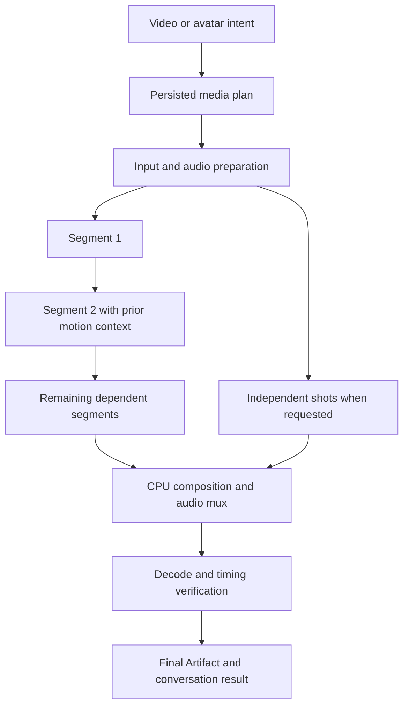

# Longer local video and avatars on bounded hardware

Original design, 2026-10-14. Segmented execution, durable Stop/resume and verified
composition are implemented. The baseline facts below describe the pre-delivery
system. Actual current qualification covers a sixty-second Wan film and a
36.52-second portrait-anchored avatar, with recorded visual limitations. A full
sixty-second uploaded-recording avatar is the next distinct acceptance profile;
its outcome must be recorded before extending the qualified range. Broader
durations, quality settings and concurrent two-GPU shots are separate gates.
See [current release acceptance](platform-acceptance-audit.md) and the implemented
[execution contract](../long-media.md).
Part of the [delivery brief](2026-10-chat-work-media.md). User intent is useful
longer films and full speaking avatars, with good UI and existing two-GPU hardware.
The solution must produce new generated motion, not stretch, loop or freeze a
three-second clip and call it a long generation.

## 1. Verified baseline and its implications

| Component | Inspected fact | Consequence |
| --- | --- | --- |
| Wan control plane + Runner | Both VideoRequest schemas allow only 17/33/49/65/81 frames; 24 fps | Maximum requested clip is 3.375 s; frontend only exposes 33/49/81 |
| Wan wrapper | `video_job.py` uses fixed ComfyUI built-ins, CPU text encoding, low-VRAM sampling, one selected GPU, whole-clip VAE decode, `signal.alarm(3600)` | Raising a dropdown cannot deliver arbitrary duration; tensor/RAM/timeout policy must change |
| Installed ComfyUI | Revision `387f98aa`; `Wan22ImageToVideoLatent` uses temporal stride 4 and accepts a batch of initial frames | `4n+1` segment sizes and a possible continuation context are available; continuity still needs qualification |
| EchoMimic API + Runner | AvatarRequest permits 17–81 frames at 25 fps; input PCM WAV is bounded to 0.68–60 s | Video covers at most 3.24 s even if speech is much longer |
| Installed EchoMimic | Revision `7e89489`; `infer_flash.py` computes min(audio duration × fps, requested frames), rounds down to the VAE stride, slices audio and muxes only that prefix | Current typed speech → avatar intentionally loses the remaining spoken text |
| EchoMimic adapter | `echomimic_entry.py` imports flash inference and adds sequential CPU offload without changing installed source | Preserve this ownership boundary, but add an app-owned long-duration entry path |
| Alternate installed Echo path | `infer_preview.py` contains overlapping-window/long-video logic, but imports non-`_2512` transformer/pipeline; flash uses `_2512` versions | Do not point flash weights at preview code or assume its flags work in flash |
| Shared orchestration | Three worker slots; durable RunDependency; HostMediaExecutor owns GPU dispatch/poll/adoption | Reuse these, adding explicit composition and a bounded media graph |
| Current media projection | `media_workflow.py` follows one child pointer and caps at 40 steps | It cannot represent parallel shots or a long segmented graph; add a paginated graph view without breaking old chains |
| Workstation read-only observation | 2 × 12288 MiB RTX 3060, about 32 GiB system RAM | VRAM is per device; CPU offload RAM may be the tighter concurrency bound |

Existing [Wan acceptance](../video.md) recorded 49 frames at 1280×704 in 398 s
and image-conditioned 33 frames in 288 s. Existing [avatar acceptance](../avatars.md)
recorded 17 frames at 256×240 with audio. Those establish short execution, not
long-film quality or concurrent fit. Do not extrapolate a promised deadline from
those two Wan timings; use measured profiles and a range, or no ETA initially.

## 2. Product output and duration controls

Video keeps **Create a scene** and **Animate an image**, adding duration in seconds
and an optional **Multiple shots** choice. Initial delivery targets 15/30/60 s,
with custom duration bounded by the qualified profile. Existing short choices
remain available. A continuous scene continues preceding motion; multiple shots
are a montage with deliberate cuts. The UI must not silently turn a requested
continuous take into unrelated shots.

Avatars defaults to **Full recording / full spoken text**, alongside **Preview**
and an explicit **Selected excerpt**. It displays the actual speech duration after
upload/TTS, not a frame-count radio list. First acceptance target: 30 and 60 s
recordings; then 120 s after extending and testing input/TTS constraints. For a
long script, sentence-based speech chunks are explicit workflow stages, maintain
voice settings, and become one continuous canonical audio track before animation.
The current 1000-character TTS limit must not be silently bypassed or truncated.

Quality/format/duration are primary controls. Steps, seed, segment size, overlap,
GPU details and backend versions are advanced. Show a short expected-work summary:
duration, output dimensions, local execution, number of shots/segments and an
estimated range only when measurements exist. Ordinary Generate is sufficient
authorization for that bounded local media plan; no approval dialog per segment.
An unavailable combination offers an actionable profile change without silently
lowering selected resolution/quality.

During work, show one job card with Preparing, Segment x/y, Composing, Verifying,
and a stable final player. Surface one current partial preview separately. Keep
Stop, completed segments and **Resume unfinished work** after a recoverable stop.
Refresh and route navigation must retain the same job. In Library, group segments
under the final result; intermediate artifacts are inspectable but do not flood
the default collection. Chat/Work and dedicated pages use the same API/cards.

The first advertised maximum is the largest duration with real acceptance, not
an arbitrary 81-frame constant. Keep an administrator-set bounded ceiling and
segment-count/disk/runtime limits (design ceiling 300 s, at most 256 generated
segments and 1024 graph nodes). These ceilings are guardrails, not a promise that
300 s is qualified. A 60 s profile can ship while 120/300 s remains unqualified.

## 3. Architecture: compose existing Runs

One user request is a Task. A short planner Run validates/snapshots the plan and
publishes ordinary dependent Runs; it then finishes as **plan prepared**, not
**film finished**. Do not hold a worker slot or GPU lock just to wait for children.
The Task projection aggregates the current plan revision and all selected stage
attempts. Final job success requires a verified final artifact.

Use existing RunDependency for ordering, not parent_run_id alone. Parentage is
provenance; dependency edges express scheduling. All same-job nodes retain the
Task/conversation, snapshotted permissions and input lineage. Do not introduce a
second queue, service, Redis, workflow language or arbitrary ComfyUI graph API.

Proposed entry schemas add a typed `duration_seconds`/`duration_mode`,
`composition_mode = continuous | shots`, profile ID/version and media inputs.
Keep the existing short-clip endpoints/requests compatible. Never accept both a
contradictory `frames` value and new duration silently. A shared normalized plan
is used by `/api/video`, `/api/avatars` and assistant dispatch.

Proposed common read/control contract, additive to existing short-Run URLs:

| Proposed operation | Contract |
| --- | --- |
| `GET /api/media/jobs/{task_id}` | Validated media Task only; current revision, selected stage attempts, aggregate state, completed/total segments, current stage, partial/final artifact IDs and explicit resume eligibility/reason |
| `GET /api/media/jobs/{task_id}/stages` | Cursor-paged bounded stage details/events; do not return an unbounded graph in each poll |
| `POST /api/media/jobs/{task_id}/cancel` | Expected plan revision; transactional cancellation intent plus existing owned-Run cancel requests; no inference or process wait in the handler |
| `POST /api/media/jobs/{task_id}/resume` | Expected revision and UUID request receipt; validate reusable completion, enqueue missing attempts/dependencies, return the selected new revision; no inline inference |

These routes are proposed, not operational. A duplicate accepted resume returns the
same revision/attempt IDs; a reused UUID with different input or a stale revision is
409. Keep historical failure/cancellation visible. Aggregate state is derived from
the selected plan revision: preparing, queued/waiting resources, generating, composing,
verifying, succeeded, failed, cancel_requested, canceled or interrupted. No new Run
state machine is needed. Planner success never sets aggregate `succeeded`; only an
adopted verified final artifact does. Search, Chat and dedicated workspaces consume
one projection; do not poll different chains and disagree about job completion.

Persist a versioned, strictly validated `MediaPlan` in Task metadata plus a JSON
plan artifact. Fields:

- plan ID/revision, task ID, backend/profile version and input artifact IDs/hashes;
- rational fps, target integer frames, dimensions, selected quality, speech sample
  count/rate when applicable; requested and effective duration;
- mode/shot descriptions, bounded segment size, overlap, deterministic segment seeds;
- ordered stage keys and dependency keys, frame/sample intervals, expected outputs;
- resource estimates/limits, concurrency cap, deadline and explicit cancel marker;
- current selected attempt Run IDs, final artifact ID and revision provenance.

Keep generated paths relative to app data. Deterministic per-stage seeds are
derived from a stored master seed and ordinal, not Python's randomized `hash()`;
resuming the same segment preserves its seed unless the user asks to regenerate.

Publication is idempotent: assign child UUIDs in the durable plan, publish once
inside the planner transaction, and record the mapping. Add a nullable Run
`operation_key` with a unique `(task_id, operation_key)` constraint via Alembic
for keys such as `media:<revision>:segment:<index>:attempt:<n>`; existing Runs
remain NULL. A concurrent/recovered publisher cannot create duplicate stages.
Output registration and terminal success commit together; downstream inputs resolve
only from a successful prerequisite's adopted artifact with matching identity/hash.
Never accept an arbitrary caller-provided output path or glob an external folder.

## 4. Scheduling, cancellation, recovery and resume

- The plan snapshot is immutable. Stage attempt status changes through Runs; retry
  creates a recorded plan revision/attempt map referencing proven successful inputs.
  Do not rewrite failed Runs to success or change inputs of an already dispatched Run.
- Add a task-level Stop operation for this validated media graph. Under the same
  transaction boundary as child publication it sets cancellation intent and requests
  cancellation on every active owned descendant, including parallel shots. Queued
  future children cannot escape it. Keep existing single-Run cancellation compatible.
- Workers/native processes retain current lease, identity and owned process-group
  semantics. After SIGTERM/SIGKILL, release reservations only after process exit is
  confirmed. Preserve uncertain ownership for inspection; do not blindly replay.
- Before native dispatch, persist dispatch_attempted. After response loss, inspect
  that exact run/process/output manifest. A valid-looking MP4 alone is insufficient
  proof of a successfully completed process. Native completion must be authoritative.
- Completed segments are reusable only after hash, media metadata, profile/input
  identity and confirmed completion checks. Resume creates new attempts for missing
  or failed stages, plus their invalidated downstream dependants; selected successful
  stages are reused without executing them again. Changed prompt/model/settings is
  a new revision with explicit invalidation, not a misleading resume.
- Resolve failed/canceled dependencies deterministically; no queued stage may wait
  forever for a dependency that cannot succeed. The selected attempt map drives the
  current job status; earlier failures remain visible in history.
- Global job deadline and per-stage timeouts are separate. The current one-hour
  Wan wrapper limit remains a segment guard, not a silent one-hour limit for an
  entire multi-hour film. Typed profile bounds control both. Enforce remaining
  deadline at dispatch, during inference and CPU composition.
- Graph projection and cancellation validate membership, allowed executor family,
  acyclicity and bounded graph size. Use pagination for events/stages. Preserve old
  sequential media URLs and assistant result links; do not merely raise 40 to infinity.

Test cancel-vs-completion/next-child races, two publishers, worker restart during
segment/mux/adoption, absent process, lost Runner reply and duplicate resume click.
Resource ownership and final artifact uniqueness must hold in every case.

## 5. Wan duration and visual continuity

Retain the installed Wan 2.2 TI2V 5B profile and existing low-VRAM execution first.
Do not replace it with an uninstalled model to claim a faster result. Each inference
window stays `4n+1` frames; begin qualification with the existing 49/81-frame sizes.
Test 121-frame windows separately before publishing a larger per-window option.

For a requested duration D at 24 fps, use integer target `N = round(D * 24)`.
All offsets/trims are integer frames, not repeated floating-point seconds. The
profile defines generation window G and validated overlap O. Windows cover the
same global timeline: first contributes G frames, each later contributes G−O;
pad only the last inference window to a valid size, then trim output to N.
The final duration differs from the request by at most one output frame.

Continuous-scene implementation:

1. Generate the first window from text or the selected first-frame artifact.
2. Decode/extract a bounded tail into owned context artifacts. The current ComfyUI
   node accepts multiple starting images, but the wrapper currently sends one.
   Qualify 5/9-frame conditioning windows against a one-frame baseline; do not
   assume a larger initial-frame tensor guarantees smooth motion.
3. Next Run receives only verified previous output/context IDs, the consistent
   scene description and selected seed. It cannot read arbitrary video paths.
4. Align overlap at the same global frame positions. Prefer exact removal of a
   preserved conditioning prefix; use a short visual blend only when accepted
   tests demonstrate improvement. Crossfade is not a cure for identity drift and
   must not duplicate duration or create ghost faces.
5. Verify movement and join quality, then encode the final output once. Avoid
   recursively using already re-encoded montage output as future context.

Multi-shot implementation: represent each shot's prompt, duration and optional
reference explicitly. Independent shots can render on separate devices, then
compose in specified order with cuts or chosen transitions. The shot plan can be
suggested from a prompt and shown as a compact editable card; segmentation of a
single requested scene does not require the user to edit a storyboard.

Current Wan `video_job.py` holds an entire decoded clip tensor; keep decoding
bounded to one segment and stream frames into composition. Do not concatenate a
minute of float tensors in RAM. Any prompt-embedding cache must be app-owned,
versioned by model/prompt/settings hashes, bounded and opaque to caller paths.
It is an optimization after correctness, not a prerequisite for the first delivery.

The [official Wan repository](https://github.com/Wan-Video/Wan2.2) describes TI2V-5B
24 fps generation and a separate distributed inference path. That path is not
the current ComfyUI adapter. Do not pass distributed flags to ComfyUI or infer
two-card support from llama.cpp. Model sharding may be investigated later only
after a compatible fixed adapter and memory measurements exist.

## 6. Full-speech EchoMimic without audio truncation

Use the existing flash weights and inspected API as the first target. The
[official EchoMimic repository](https://github.com/antgroup/echomimic_v3) describes
long-video options, but the installed preview and flash paths differ. Compatibility
must be established from local source/checkpoint structure before importing a
different pipeline. Never change the original installed source to make it work.

First engineering gate: inspect the flash pipeline's conditioning mask and audio
embedding layout, and implement a project-owned windowed adapter around its
supported calls. The installed `get_image_to_video_latent2` and pipeline accept
video/mask inputs; qualify retained tail frames and a stable portrait identity
anchor. Do not copy preview's audio index scaling (`* 2`) into flash: their embedding
layouts differ. If this cannot preserve identity/lip timing, investigate the
installed preview path only after proving checkpoint compatibility. New weights
are a separate explicit decision, not an automatic download or hidden fallback.

Canonical audio determines time:

Use integer/rational math: for S samples at sample rate R and frame rate P/Q,
the full-recording target is `N = ceil(S * P / (R * Q))`. Audio remains exactly S
samples; the video padding is less than one output frame. Plan an audio boundary
at video frame F from the absolute rational `F * R * Q / P`, consistently rounded
and clamped to `[0,S]`. Never independently round each chunk's duration and sum it.

1. Validate/decode the complete PCM WAV, preserve its sample count/rate, and derive
   frame count using rational 25 fps timing. If using typed text, finish the TTS
   workflow and validate the entire resulting speech before choosing video windows.
2. Define each window in the global audio/video timeline, including overlap.
   Compute audio slice boundaries from absolute frame indexes and sample rate;
   rounding once per boundary prevents accumulating drift.
3. Give each window its corresponding speech plus bounded context padding. For the
   final partial window, pad input with silence to a valid model frame size and
   later trim exactly. Never drop the last words to fit `4n+1`.
4. Carry validated preceding motion context into the next window while retaining
   the original identity reference. Start with 49/65/81 frames; compare quality.
   Independent avatar windows with the original portrait only are a diagnostic
   baseline, not accepted seamless output if head pose jumps at every boundary.
5. Remove/blend only matched visual overlap. Mux the original canonical audio
   **once** into the final stream. Do not concatenate repeated per-segment AAC
   audio, time-stretch speech or crossfade duplicate spoken syllables.
6. Output video covers the full audio; allow at most one frame of final padding.
   Container duration, final audible phrase, lip sync and continuity are checked.

Initial shipped Full recording duration can reuse the existing ≤60 s upload
contract. The 120 s milestone must update control-plane uploads, Runner WAV
validation, speech-result validation, metadata and UI together. Keep bounded file
bytes/sample rates/channels and stream processing; accepted duration does not imply
every sample-rate/channel combination fits the byte limit. Explain a rejected
format before queueing and offer a deliberate supported conversion if implemented.

Sentence-based long TTS must preserve order, language, voice reference and pauses.
Reuse the completed canonical WAV after a failed avatar stage; no repeated TTS or
voice change on Resume. Store sentence/window lineage without publishing hundreds
of default Library cards. Avatar animation remains a sequential dependency for
continuous motion; extra GPUs do not remove that dependency.

## 7. CPU composition, artifact and security contract

Add a fixed typed native media-composition operation, not a shell/ffmpeg command
endpoint. Inputs are validated app-owned artifacts plus numeric frame/sample trim
intervals, a supported output profile and optional canonical audio ID. Resolve
IDs to canonical allowed paths, recheck type/hash/size and symlink boundaries at
use. Forbid arbitrary URLs, protocols, filter text, codec arguments and host paths.

Prefer existing PyAV for bounded streaming decode/encode. If an ffmpeg subprocess
is used, build fixed argv with `shell=False` and an app-generated local manifest;
enforce local-file protocol restrictions, bounded codecs/threads and process-group
ownership. No caller concat lists, shell expansion, network fetch or external
ComfyUI control. It is a CPU executor; do not route it through a GPU-only success
assumption in HostMediaExecutor.

Write `.partial` in the owned Run directory, close/flush and fully validate before
atomic rename and artifact adoption. Normalize frame rate, time base, dimensions,
pixel format and codec across segments. Do not stream-copy incompatible segments.
Verification decodes every frame for truncated/corrupt data, checks monotonically
increasing timestamps, target frame count, audio duration/track where required,
and rejects empty/black/corrupt output with an inspectable failure. Visual quality
still requires human inspection; an automated black-frame check is not enough.

Final Artifact metadata records actual duration/fps/frames/dimensions, backend,
profile, plan revision, source and segment IDs, audio identity, seeds, requested
and actual resources. Source lineage is preserved across preparation/TTS/windows/
composition. Completed intermediates survive cancellation; cleanup only targets
owned unreferenced scratch under the normal retention policy. Never delete models,
uploaded sources or evidence needed for resume as part of emergency cleanup.

## 8. Two-GPU resource admission

GPU locks alone do not limit CPU text encoder/offload RAM. Add profile resource
estimates to requested_resources and enforce host RAM plus GPU reservations before
dispatch. Use dynamically observed free VRAM and RAM with a safety margin (initial
policy candidate: max(4 GiB, 20% of total RAM), to tune from measurement). Do not
count swap as capacity. Recheck actual availability at dispatch; external processes
may change it and are never terminated to make room.

RAM admission and GPU acquisition must share an atomic reservation transaction,
with per-Run reserved bytes persisted in the existing resource records/metadata.
Subtract pending reservations from observed capacity; avoid double-counting memory
already reflected in live usage when combining observations with reservations.
Two worker slots must not both admit against the same free-memory snapshot.
Release all reservations only after owned process termination is confirmed;
uncertain dispatch keeps them held until reconciliation. Any added database
constraints/columns require a migration and concurrent-claim tests.

Default heavy-media concurrency is one until a measured two-job combination fits
the workstation. Bound CPU text encoding separately to avoid simultaneous encoder
peaks, but account for weights retained by a process after encoding as well.
Independent shots can occupy both GPUs only when their combined measured peak RAM
and each device's VRAM pass admission. Otherwise queue one with a visible reason;
having three worker slots is not proof of three safe heavy jobs.

Continuous segments stay sequential by dependency. A second device may serve
another admitted job or, in a separately qualified adapter, an explicit encoder/
decoder placement. No automatic multi-device inference/sharding is promised.
Reuse owned-LLM idle eviction; never stop external Ollama/ComfyUI or an active
consumer. A blocked media plan must not occupy a worker slot indefinitely or
starve short Chat work. Use bounded resource-wait requeue/backoff and fair queueing.

Record measured peak VRAM/RSS, phase times, chosen device and waits by profile.
Expose qualified concurrency in capabilities. On OOM, preserve completed segments
and report the failed attempt; offer an explicit smaller profile/resume. Do not
quietly reduce image quality, retry indefinitely or automatically use a paid API.

## 9. Code map and verification matrix

Extend: `backend/app/video.py`, `avatars.py`, `audio.py`, `assistant.py`,
`host_media_executor.py`, `media_workflow.py`, `dependencies.py`, `resources.py`,
`runs.py` and artifact/task projections. Add small typed media-plan/composition
modules and Alembic operation-key migration. Use existing executor registration.

Runner: `video.py`, `video_job.py`, `avatars.py`, `echomimic_entry.py`, new fixed
composition/window entry modules, existing process manager/telemetry. Keep installed
ComfyUI/EchoMimic/weights read-only. UI: `Video.tsx`, `Avatars.tsx`,
`AvatarChoiceLists.tsx`, assistant options/results, Run detail, Library grouping.
Update video/avatar/speaking-avatar/execution/security docs when behavior lands.

| Layer | Required proof |
| --- | --- |
| Plan math | 24/25 fps, `4n+1`, short final windows, exact overlap, noninteger requested seconds, audio rates, max bounds, deterministic seeds and duration tolerances |
| Normal integration | Fake segments on temporary DB/data: parallel shots, serial continuation, input lineage, one final artifact, cancellation races, dependency failure, duplicate publication and resume, API/worker restart |
| CPU integration | Real generated disposable clips/WAV: concat/mux/decode, frame/sample accounting, differing time bases, missing/truncated outputs, disk failure and owned process cancellation |
| Native security | Path/symlink/URL/protocol rejection, fixed argv, external process untouched, missing profile/weights unavailable, permissions and owned completion required |
| Single-GPU Wan | ≥15 s continuous scene plus ≥30 s deliberate multi-shot output; inspect joins, identity, motion and full playback; preserve current accepted native resolution |
| Avatar | 30 s and 60 s speech with distinct phrases crossing boundaries and at end; listen to entirety, inspect lip sync/head/identity at every join; then independently qualify 120 s |
| Two-GPU | Independent shots on both devices with measured combined RAM/VRAM; pressure scenario queues safely; active Chat and unrelated processes remain responsive |
| Reliability | Cancel mid-segment and mid-mux; restart worker/API between segments; Resume reuses hashes of completed segments and produces no duplicates |
| UX | Chat and dedicated workspaces, refresh/deep links, progress without false percentages, final/partial grouping, Stop/Resume, mobile playback/download and no overflow |

Build the fake/CPU matrix before expensive hardware runs. Qualify the smallest
representative real window/continuation first, then one useful long output per
mode. Record result IDs, decoded metadata, timings, peak resources and quality
observations in `data/acceptance/long-media-<date>`; summarize truthfully in docs.
No inference or long-output claim was made while writing this plan.
