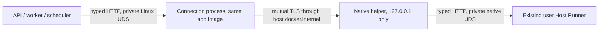

# Private Mac Runner connection across Docker Desktop

NR-13/14 keeps the Docker control plane, native user Runner and typed HTTP API.
This is an implementation contract; complete Mac consumer admission stays gated.

## Actual constraint, 2026-11-02

The [actual Intel experiment](https://github.com/jahu/ai-station/actions/runs/41426684034)
installed hash-verified signed Docker Desktop 4.97.0, started its Linux/x86-64
engine and executed the pinned non-root client. The client reported `OSError`,
Linux errno 95 (`EOPNOTSUPP`); the native socket listener received no connection.
Owned probe cleanup and normal Desktop Stop passed. Earlier Launch Services,
readiness and vendor-install umask problems were corrected independently.
This does not qualify shared files/WAL, other backends or the consumer installer.
The observed ARM hosted host separately refuses empty VM creation, which is not
a claim about all physical ARM Macs.

The first authenticated [real Mac experiment](https://github.com/jahu/ai-station/actions/runs/41432615972)
did reach the native nonce protocol, create/read its private shared artifact and
hold a Linux SQLite writer transaction. It then found that an attempted native
macOS SQLite writer was not excluded. Host/VM SQLite lock domains must therefore
not be treated as interchangeable. The existing architecture keeps all live DB
writers in the Docker control plane; the native Runner/launcher bundle contains
no application DB backend, and preserving upgrades use the fixed application-image
transaction command. Native `station_recovery` is not included in that bundle;
Mac recovery must use the quiescent image path, not Linux `/proc` host checks.

Qualify the actual writer topology: a second independently created, non-root,
network-isolated container must observe WAL mode, no uncommitted row and an actual
`SQLITE_BUSY` result while the first container holds its writer transaction.
After commit, a fresh container must verify the stored value, integrity, WAL mode
and released writer lock. Native inspection checks shared artifact bytes and
ownership without opening SQLite. Keep the failed cross-kernel experiment as a
documented constraint; do not report native/live-VM DB access as supported or
silently ignore a failed container-writer check.

Do not change an existing user's VMM/settings to make socket sharing pass.
Docker's [host-service networking](https://docs.docker.com/desktop/features/networking/networking-how-tos/)
supplies a candidate local leg; verify it on the actual Mac before activation.

## Selected topology

The connection process is transport infrastructure, with no task engine, database,
commands, arbitrary targets or Docker authority. `RunnerClient`, account isolation,
permissions, native validation, Run identities, Stop and inspect-before-retry
recovery remain unchanged. Linux/WSL retain their working direct socket path.

1. The trusted supervisor creates fresh private certificates outside app data:
   a local CA and separate server/client TLS purposes. No OS trust-store change,
   external certificate service or account password is involved. Mount only the
   client certificate/key and CA read-only; server/issuer keys stay native.
   Keys never enter artifacts, normal API responses, settings, logs or prompts.
2. The native helper requires mutual TLS, binds only `127.0.0.1` at an OS-selected
   nonprivileged port and connects only to the frozen Runner socket after owner
   and kernel-peer checks. No unencrypted fallback, LAN/public bind or new Runner
   endpoint is allowed. The container verifies the private CA and fixed server
   hostname; callers cannot select arbitrary network destinations.
3. A small private named tmpfs volume holds the Linux socket, with the service's
   UID/GID and mode-0700 directory/mode-0600 socket. API/worker/scheduler mount it
   read-only at `/runner`; only the connection process writes it. A held file
   lock and private inode receipt fence stale owned sockets and preserve unknown
   replacements. User data remains a host bind mount; never use `--volumes`.
4. A Mac Compose overlay adds one non-root process using the same application
   image and replaces the native socket-directory mount. No proxy image, root
   daemon, host filesystem exposure or independent durable service is introduced.
   Certificates/numeric port are trusted supervisor configuration, never Run
   parameters. Existing `RunnerClient` still uses `/runner/runner.sock`.
5. Retain the immediate native helper handle and a parent-liveness pipe; owner
   exit closes the listener instead of leaving an orphan. Bound handshakes,
   connection count, buffers and lifetime; preserve streaming and backpressure.
   Connection loss must not re-execute a previously dispatched Run.
6. Start after native Runner identity/readiness. The connection health check must
   traverse both private sockets and TLS to that Runner. Preserve first-admin
   handoff, matching API readiness, pinned Docker connection, version/upgrade
   fences, preserving migrations and data-preserving owned shutdown.

## Qualification sequence

- Actual same-host UDS → mutual TLS → UDS with neutral HTTP/streaming. Reject
  absent/foreign certificates, wrong native peers, changed credential/socket
  files and public targets. Check concurrent streams, backpressure, parent exit,
  stale-owner races and bounded Stop without signaling another process.
- On the actual disposable Intel Mac/Desktop, verify that full path from a
  container, then independently check chosen-filesystem artifacts, SQLite WAL,
  writer locking, commit and client restart. Preserve the negative direct-socket
  result; only a successful authenticated alternative qualifies the new path.
- Then use the bundled app/native Runner/launcher for first admin, guided matching
  CPU model, real streaming, Stop, history, update and removal. Repeat on suitable
  ARM hardware. Metal, minimum OS and signing remain independent gates; component
  fixtures cannot enable the consumer path or waive actual failures.

Keep all original NR-01–NR-14 requirements, speech/scenes quality, Windows GPU,
naming and the release-specific operator workbook in the full release objective.
