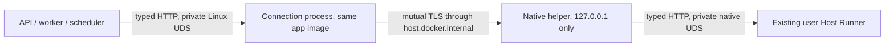

# Private Mac Runner connection across Docker Desktop

NR-13/14 keeps the Docker control plane, native user Runner and typed HTTP API.
This is an implementation contract; complete Mac consumer admission stays gated.

## Actual constraint, 2026-11-02

The [actual Intel experiment](https://github.com/jahu/ai-station/actions/runs/41426684034)
installed hash-verified signed Docker Desktop 4.97.0, started its Linux/x86-64
engine and executed the pinned non-root client. The client reported `OSError`,
Linux errno 95 (`EOPNOTSUPP`); the native socket listener received no connection.
Owned probe cleanup and normal Desktop Stop passed. Earlier Launch Services,
readiness and vendor-install umask problems were corrected independently.
This does not qualify shared files/WAL, other backends or the consumer installer.
The observed ARM hosted host separately refuses empty VM creation, which is not
a claim about all physical ARM Macs.

The first authenticated [real Mac experiment](https://github.com/jahu/ai-station/actions/runs/41432615972)
did reach the native nonce protocol, create/read its private shared artifact and
hold a Linux SQLite writer transaction. It then found that an attempted native
macOS SQLite writer was not excluded. Host/VM SQLite lock domains must therefore
not be treated as interchangeable. The existing architecture keeps all live DB
writers in the Docker control plane; the native Runner/launcher bundle contains
no application DB backend, and preserving upgrades use the fixed application-image
transaction command. Native `station_recovery` is not included in that bundle;
Mac recovery must use the quiescent image path, not Linux `/proc` host checks.

Qualify the actual writer topology: a second independently created, non-root,
network-isolated container must observe WAL mode, no uncommitted row and an actual
`SQLITE_BUSY` result while the first container holds its writer transaction.
After commit, a fresh container must verify the stored value, integrity, WAL mode
and released writer lock. Native inspection checks shared artifact bytes and
ownership without opening SQLite. Keep the failed cross-kernel experiment as a
documented constraint; do not report native/live-VM DB access as supported or
silently ignore a failed container-writer check.

The [follow-up with independent container writers](https://github.com/jahu/ai-station/actions/runs/41438708075)
reported `SQLiteWriterNotExcluded`. Review then found that the original holder's
15-second socket deadline could expire during slow contender container creation.
That result alone does not establish a filesystem locking defect. The strengthened
protocol keeps a bounded 90-second holder and requires an explicit in-transaction
acknowledgement after the contender's attempt, including failed attempts. A lost
holder is a failed experiment, never an accepted unsafe-filesystem negative control.
Do not enable the consumer launcher until the strengthened shared-folder test
passes. If it instead confirms missing exclusion with a live holder, a fallback
candidate keeps artifacts/models/uploads on the selected bind mount but places
`/data/db` on a project-owned persistent local Docker volume.

The [strengthened actual Mac run](https://github.com/jahu/ai-station/actions/runs/41441710314)
now confirms that distinction: the bind-mount contender reported
`SQLiteWriterNotExcluded` **and** the original writer subsequently acknowledged
its still-open transaction. The same run's local-volume candidate passed writer
exclusion, uncommitted-row isolation, live-holder acknowledgement, commit,
integrity, client restart, native TLS/Unix nonce exchange, artifact ownership and
cleanup. Docker Desktop stopped normally. Thus the selected tested Mac topology
requires local Docker DB storage; a raw Mac bind mount is not an admissible DB
substitute. This is evidence for the observed Intel backend, not a blanket claim
about every Mac/VMM. It does not qualify the full installer or Metal.

All API/worker/scheduler and quiescent upgrade DB commands must use that same
attested volume. A new disposable probe volume first has to pass the unchanged
writer exclusion/visibility/integrity/restart tests. One fixed isolated initializer
may set ownership only on its just-created empty volume; it mounts no host path
and has only the required ownership capability. Regular clients stay non-root.

Adopting that storage change also requires explicit preserving-update, offline backup/export,
restore and data-preserving uninstall/reinstall qualification before admission.
An exported consistent backup belongs under the chosen app-data folder; a stale
host DB must never be mistaken for the active volume DB. A copied host directory
alone is not a complete Mac backup. Do not silently remove a volume on Stop,
update or uninstall, import an existing host DB, or admit an unknown volume.

The fixed image upgrade stages new operations inside `db/desktop-upgrade-staging`
when its DB and exported-backup filesystems differ. A request-bound relative
location prevents selecting arbitrary paths. Exported pre-update backups remain
under `desktop-upgrades`, and existing same-filesystem/pending Linux operations
retain their original location. Publication checks that the stage and target
share a Linux mount identity before changing phase or removing WAL sidecars, then uses the
existing atomic replace. This supplies the cross-filesystem backend primitive;
native volume attestation, activation and complete Mac update acceptance remain
separate integration requirements.

The Linux image inspects its own open directory's `/proc/self/fdinfo` mount ID
as well as the device number. Separate bind mounts may share `st_dev` but still
reject cross-mount rename with `EXDEV`; device equality alone is insufficient.
These mount IDs are compared within one command, never persisted or compared
between containers or operating systems.

SQLite's [locking requirements](https://www.sqlite.org/howtocorrupt.html)
and [WAL shared-memory contract](https://www.sqlite.org/wal.html) explain why
reported WAL mode alone is insufficient. The selected storage must demonstrate
actual exclusion and shared visibility; a positive local Linux fixture cannot
stand in for a failed Mac filesystem test.

Do not change an existing user's VMM/settings to make socket sharing pass.
Docker's [host-service networking](https://docs.docker.com/desktop/features/networking/networking-how-tos/)
supplies a candidate local leg; verify it on the actual Mac before activation.

## Selected topology

The connection process is transport infrastructure, with no task engine, database,
commands, arbitrary targets or Docker authority. `RunnerClient`, account isolation,
permissions, native validation, Run identities, Stop and inspect-before-retry
recovery remain unchanged. Linux/WSL retain their working direct socket path.

1. The trusted supervisor creates fresh private certificates outside app data:
   a local CA and separate server/client TLS purposes. No OS trust-store change,
   external certificate service or account password is involved. Mount only the
   client certificate/key and CA read-only; server/issuer keys stay native.
   Keys never enter artifacts, normal API responses, settings, logs or prompts.
2. The native helper requires mutual TLS, binds only `127.0.0.1` at an OS-selected
   nonprivileged port and connects only to the frozen Runner socket after owner
   and kernel-peer checks. No unencrypted fallback, LAN/public bind or new Runner
   endpoint is allowed. The container verifies the private CA and fixed server
   hostname; callers cannot select arbitrary network destinations.
3. A small private named tmpfs volume holds the Linux socket, with the service's
   UID/GID and mode-0700 directory/mode-0600 socket. API/worker/scheduler mount it
   read-only at `/runner`; only the connection process writes it. A held file
   lock and private inode receipt fence stale owned sockets and preserve unknown
   replacements. User data remains a host bind mount; never use `--volumes`.
4. A Mac Compose overlay adds one non-root process using the same application
   image and replaces the native socket-directory mount. No proxy image, root
   daemon, host filesystem exposure or independent durable service is introduced.
   Certificates/numeric port are trusted supervisor configuration, never Run
   parameters. Existing `RunnerClient` still uses `/runner/runner.sock`.
5. Retain the immediate native helper handle and a parent-liveness pipe; owner
   exit closes the listener instead of leaving an orphan. Bound handshakes,
   connection count, buffers and lifetime; preserve streaming and backpressure.
   Connection loss must not re-execute a previously dispatched Run.
6. Start after native Runner identity/readiness. The connection health check must
   traverse both private sockets and TLS to that Runner. Preserve first-admin
   handoff, matching API readiness, pinned Docker connection, version/upgrade
   fences, preserving migrations and data-preserving owned shutdown.

## Qualification sequence

The application-image integration uses `compose.macos.yaml` and the internal
`desktop_connection.py` entry point from the same image. Only the connection
service receives the client certificate directory; only that service writes
the private tmpfs socket volume. API, worker and scheduler retain read-only
socket mounts and wait for a health request that traverses the complete link.
The supervisor creates the native owner only after Runner identity/readiness,
monitors its retained process and stops the owned Compose project before closing
the helper. Credentials remain outside container-mounted application data; a
failed Compose shutdown retains them for inspection after the listener closes.
The pinned Mac engine selects this overlay; Linux/WSL keep their existing direct
socket and launch behavior. The full Mac consumer prerequisite gate stays closed,
and database storage, backup/update and full application qualification remain
required before admitting an installation.

The overlay additionally requires the installer's verified persistent DB volume
name and mounts it at `/data/db` in all three control-plane services. It is an
external volume: Compose must not create an implicit empty replacement or remove
it on shutdown. A missing name fails configuration before startup. Native storage
creation/attestation, offline upgrade commands and consistent export/restore must
still be connected before this candidate is admitted; do not set a foreign volume
name manually to bypass installation.

### Remaining persistent-storage integration

The native `macos_database_storage.DatabaseStorage` owner now supplies a private,
namespace/UID/GID/daemon-bound volume receipt and fixed application-image
ownership helpers. Initialization runs once on an empty root-owned local volume
with only `CHOWN`, no network or host mounts. It writes and syncs a root-owned,
read-only binding marker before publishing mode-0700 ownership to the ordinary
user. Normal inspection mounts only that volume read-only and verifies both the
marker and directory ownership, without opening SQLite. Completed lost helper
acknowledgements are inspected by exact frozen identity rather than reexecuted;
an explicit nonce-bound creation inspection can reconcile a lost volume-create
acknowledgement. Partial/failed initialization stays fenced and preserves bytes.
This owner has no volume-removal operation; Stop, update and uninstall cannot
delete storage through it. Native launch, version activation and export/restore
still need the integration and actual journey qualification below.

The actual Linux Docker lifecycle check passes native receipt recreation,
first-admin/fake Task/Run/SSE, independent-container WAL writer exclusion with
the original writer still held, no uncommitted-row visibility, commit/integrity,
fresh-client login/history/artifact preservation and ordinary-user refusal to
overwrite the root marker. It uses only newly created synthetic storage and
cleans it up separately. This is not a Mac installer or real-model test.

Fixed offline image upgrades now reuse the attested volume for prepare, publish,
abort and status. Activation reads a fixed image fingerprint through a separate
read-only mount and compares main/WAL identity with the acknowledged transaction;
the native host never opens that SQLite file. A foreign container reference or
changed bytes keeps the prior version and startup fence. Lost helper create,
start, removal and fingerprint acknowledgements are reconciled without replaying
publication. Five real disposable Linux Docker cases passed: three activation
recovery variants, abort preserving a live-format WAL, and changed-byte refusal.
They preserve accounts, password records, private settings, rows and artifacts
across schema 0041 to 0042. Both logical package versions used the same verified
image; this is component qualification, not a complete two-package Mac update.

Version namespaces now include the ready persistent volume and daemon binding.
The storage owner itself uses the unchanged base filesystem namespace to avoid
circular identity. Helper operation/phase changes cannot relocate an existing
installation; replacing the volume/daemon, removing its receipt or changing the
user/base coordinates prevents adoption. A first version needs the exact owner
and the fixed read-only image's marker-only emptiness proof; zero-byte database,
sidecar or unrelated entries are sufficient to refuse it. First-version reader
acknowledgements can be recovered without publishing a version prematurely.
The native candidate now imports its image and runs the authenticated/local-volume
probe before preparing persistent storage and publishing version state. Its child
independently verifies the package inventory, starting version, ready volume and
quiescence before any Compose operation, overrides ambient volume settings, and
pins the application image SHA. The probe requires the original SQLite writer to
remain held and the exact local-volume writer domain. Legacy proofs are accepted
only to reconcile completed cleanup before a new, stronger probe. The consumer
gate remains closed pending full journey, preserving export/restore and native
hardware/signing qualification.

Before enabling Mac installation:

1. Wire the persistent owner into native startup and offline operations before
   version readiness. Bind its private receipt outside app data to the selected directory
   identity, Compose project, UID/GID and pinned engine. Attest the exact local
   volume's name, labels, creation identity and driver options on every startup
   and offline operation. Lost creation acknowledgements keep their pending
   fence; unknown volumes are never adopted, initialized or removed. Only the
   fixed, empty-volume ownership initializer can run as root, without host mounts.
2. All three application services and every fixed offline image command mount
   that same volume at `/data/db`. Never inspect the active DB with native
   SQLite or mistake an empty/stale `db` folder on the Mac for the active database.
   A consistent backup/export remains under the selected host data folder and
   must explicitly include the DB, retained files and storage receipt.
3. Use the backend's DB-local upgrade staging when metadata and exported backups
   have different mounts. It binds the relative stage location into the request,
   preserves legacy pending operations and refuses cross-mount publication before
   changing phase or touching WAL. Keep exported pre-update backups host-backed.
   Native integration and later restoration must follow the same atomic-publication
   rule; no non-atomic copy over an active database is acceptable.
4. Native upgrade activation consumes the fixed image's attested database
   fingerprint; it cannot hash a nonexistent native `db/ai-station.sqlite`.
   Quiescence includes the owned station and every container using the volume;
   a foreign user of that volume is refused, never stopped. Version namespaces
   bind the storage receipt while existing Linux/WSL identities remain unchanged.
5. Demonstrate first admin, guided CPU model, real streaming, owned Stop,
   restart/history, preserving update/cancellation/recovery, consistent export,
   offline restoration and uninstall/reinstall preserving the same database and
   credentials. Compose Stop, update and uninstall never delete persistent DB
   storage. Only then reconsider the consumer prerequisite gate; ARM/Metal,
   signing and minimum OS remain separate qualification requirements.

- Actual same-host UDS → mutual TLS → UDS with neutral HTTP/streaming. Reject
  absent/foreign certificates, wrong native peers, changed credential/socket
  files and public targets. Check concurrent streams, backpressure, parent exit,
  stale-owner races and bounded Stop without signaling another process.
- On the actual disposable Intel Mac/Desktop, verify that full path from a
  container, then independently check chosen-filesystem artifacts, SQLite WAL,
  writer locking, commit and client restart. Preserve the negative direct-socket
  result; only a successful authenticated alternative qualifies the new path.
- Then use the bundled app/native Runner/launcher for first admin, guided matching
  CPU model, real streaming, Stop, history, update and removal. Repeat on suitable
  ARM hardware. Metal, minimum OS and signing remain independent gates; component
  fixtures cannot enable the consumer path or waive actual failures.

Keep all original NR-01–NR-14 requirements, speech/scenes quality, Windows GPU,
naming and the release-specific operator workbook in the full release objective.
